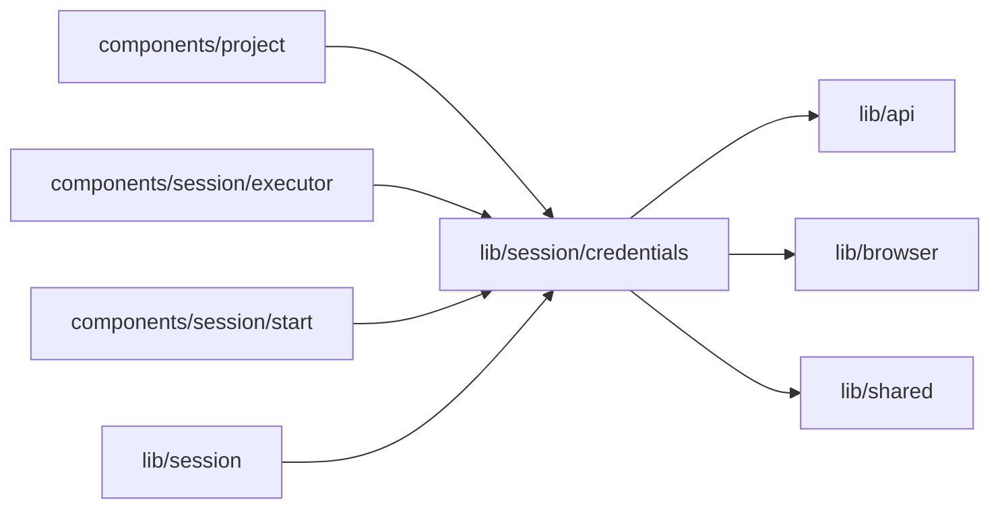

# Model credential status

<!-- BEGIN GENERATED DIRECTORY SUMMARY (scripts/check-readmes.mjs; edit only Purpose) -->
Purpose: Owns the Project page’s non-secret credential status and focus refresh.

Importers: `components/project`, `components/session/executor`, `components/session/start` and `lib/session` import this directory.

Imports: it imports `lib/api`, `lib/browser` and `lib/shared`.

<!-- END GENERATED DIRECTORY SUMMARY -->

starting-credential holds at most one staged creation and one accepted creation
in client memory. Passwords never enter browser storage, serialized creation
intents, URLs or logs. Admission is single-flight across component remounts and
uses the accepted Project's current credential revision. The existing Session
credential owner remains authoritative. Reload requires re-entry if admission
has not completed and never resends a message automatically.

Before a platform first Send crosses the RPC boundary, a session-storage marker
records only its non-secret message admission ID. Success clears it. A failed or
lost response retains it across reload and requires checking the conversation
before explicitly enabling another manual send; no credential or message content
is stored in that marker. It expires with the browser tab or explicit resolution.
