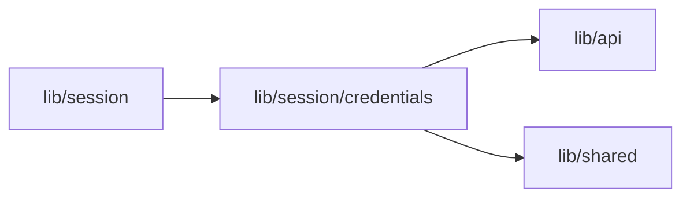

# Model credential status

<!-- BEGIN GENERATED DIRECTORY SUMMARY (scripts/check-readmes.mjs; edit only Purpose) -->
Purpose: Owns the Project page’s non-secret credential status and focus refresh.

Importers: `lib/session` imports this directory.

Imports: it imports `lib/api` and `lib/shared`.

<!-- END GENERATED DIRECTORY SUMMARY -->
