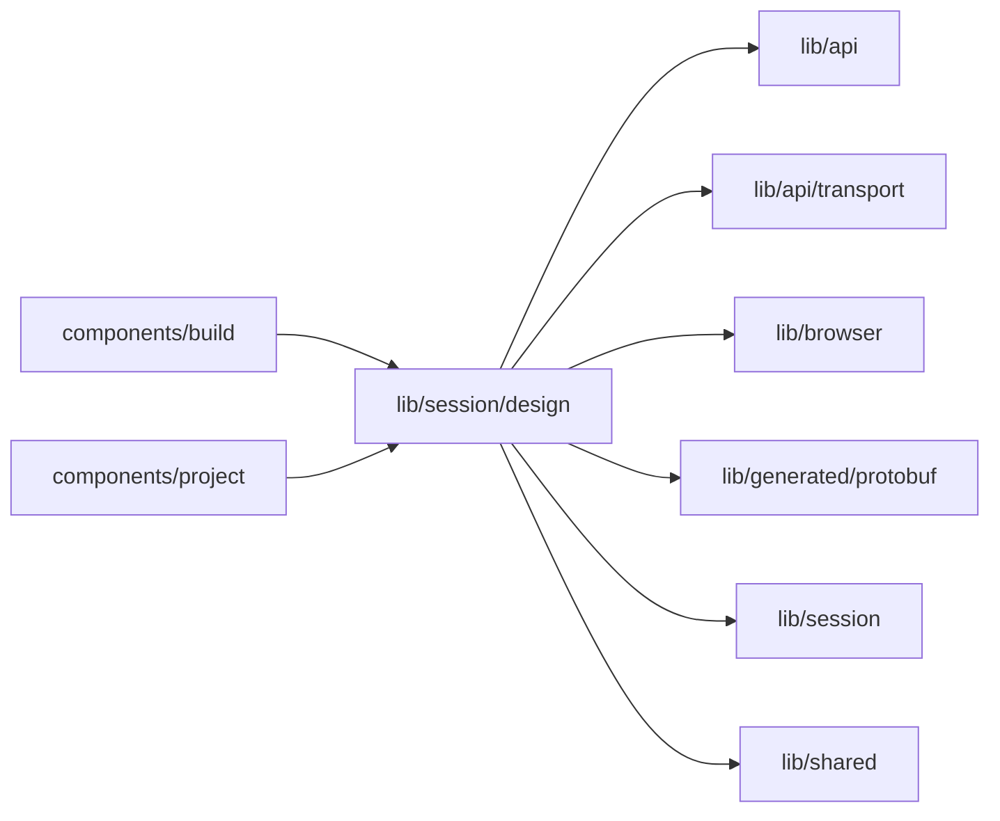

# Session Flow design

<!-- BEGIN GENERATED DIRECTORY SUMMARY (scripts/check-readmes.mjs; edit only Purpose) -->
Purpose: Reads which Flow design the Flow tab draws from the Session Snapshot, reads its body once per digest, remembers which card version it showed, and whether its Brief shows.

Importers: `components/build` and `components/project` import this directory.

Imports: it imports `lib/api`, `lib/api/transport`, `lib/browser`, `lib/generated/protobuf`, `lib/session` and `lib/shared`.

<!-- END GENERATED DIRECTORY SUMMARY -->

| File                  | Responsibility                                                                                                                                                                                                                  |
| --------------------- | ------------------------------------------------------------------------------------------------------------------------------------------------------------------------------------------------------------------------------- |
| `use-flow-design.ts`  | The design the Flow tab draws: the current version's, from its recorded card until it is built and the Preview's processes are built from the push that built it; its body through `GetFlowDesign`, cached and shared by digest; the designed Steps the agent wrote |
| `use-design-shown.ts` | The card version whose design the Flow tab last showed by itself, in browser storage, so it shows once and the tab's marker goes                                                                                                |

A stale read (`REVISION_CHANGED`) re-reads the Snapshot; a slot without a design (NOT_FOUND) draws none.
