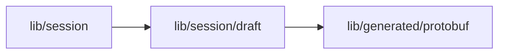

# Requirements draft

<!-- BEGIN GENERATED DIRECTORY SUMMARY (scripts/check-readmes.mjs; edit only Purpose) -->
Purpose: The requirements card the agent is still writing, as the Session Watch streams it, and when the Snapshot says its card call is over.

Importers: `lib/session` imports this directory.

Imports: it imports `lib/generated/protobuf`.

<!-- END GENERATED DIRECTORY SUMMARY -->

| File                    | Responsibility                                                                                                                                                  |
| ----------------------- | --------------------------------------------------------------------------------------------------------------------------------------------------------------- |
| `requirements-draft.ts` | The browser view of an `AgentRequirementsDraft` event and `isDraftOver`: a version recorded past its base revision, a tool result of its call or its turn's end |

The page's Session owner keeps only the newest draft and drops it once its call is over, so a lost or
late event never outlives the card. The draft is never the card: the Snapshot's recorded version is
([streaming and Studio](../../../../../docs/architecture/agent-harness-design/streaming-and-studio.md)).
