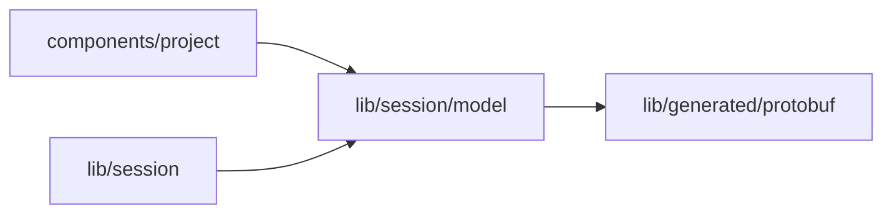

# Agent model view

<!-- BEGIN GENERATED DIRECTORY SUMMARY (scripts/check-readmes.mjs; edit only Purpose) -->
Purpose: Maps every catalog AgentModel enum explicitly to its Studio literal and back, preserving historical values and recognizing unavailable identities.

Importers: `components/project` and `lib/session` import this directory.

Imports: it imports `lib/generated/protobuf`.

<!-- END GENERATED DIRECTORY SUMMARY -->
