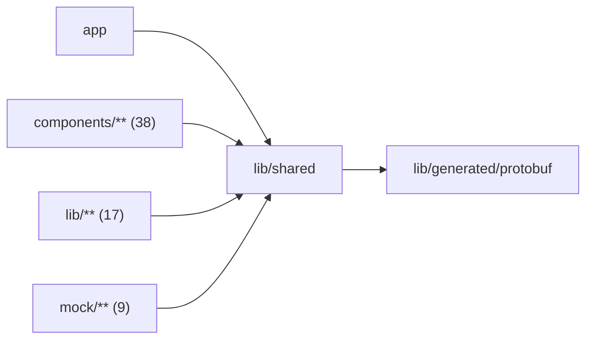

# Shared code

<!-- BEGIN GENERATED DIRECTORY SUMMARY (scripts/check-readmes.mjs; edit only Purpose) -->
Purpose: Pure code both sides use: protobuf and JSON types, formatting, abort and delay, RPC method types, Session command errors, Project availability, Flow Definition catalogs and Studio routes.

Importers: `app`, `components/**` (38), `lib/**` (17) and `mock/**` (9) import this directory.

Imports: it imports `lib/generated/protobuf`.

<!-- END GENERATED DIRECTORY SUMMARY -->

`studio-routes.ts` (`studioRoutes`, `flowApiRoutes`, `flowTargetHref`,
`withQueryChanges`) builds every Studio page URL, Flow view link and
Project-scoped Flow API base path. Nothing here imports React, Next or Node.
