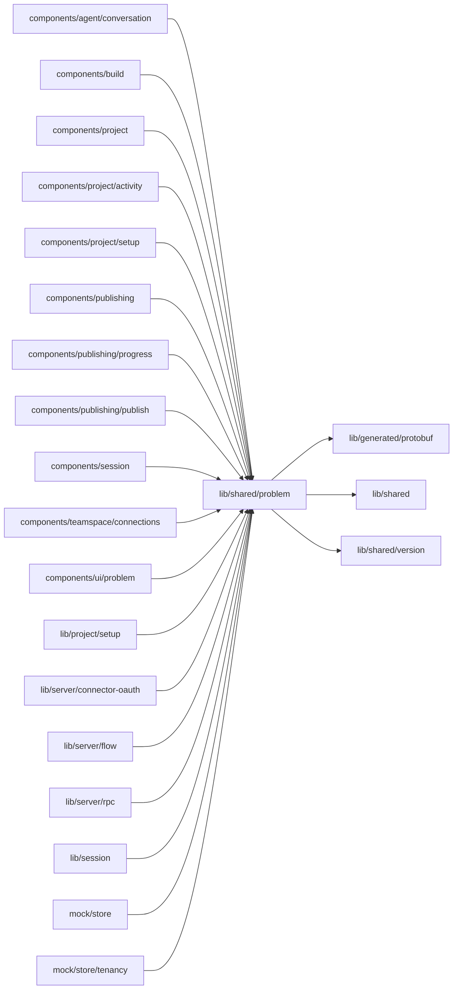

# lib/shared/problem

<!-- BEGIN GENERATED DIRECTORY SUMMARY (scripts/check-readmes.mjs; edit only Purpose) -->
Purpose: The one problem format's copy: remedy buttons, what-happened phrases, gap phrases, refusal texts and the builders that turn a failure, an error or a notice into a problem.

Importers: `components/agent/conversation`, `components/build`, `components/project`, `components/project/activity`, `components/project/setup`, `components/publishing`, `components/publishing/progress`, `components/publishing/publish`, `components/session`, `components/teamspace/connections`, `components/ui/problem`, `lib/project/setup`, `lib/server/connector-oauth`, `lib/server/flow`, `lib/server/rpc`, `lib/session`, `mock/store` and `mock/store/tenancy` import this directory.

Imports: it imports `lib/generated/protobuf`, `lib/shared` and `lib/shared/version`.

<!-- END GENERATED DIRECTORY SUMMARY -->

`problem.ts` builds a `Problem` (what happened, why, the remedy, the configuration gaps, the version
and the folded technical details) from a recorded `Failure`, from a refused request's ErrorInfo or
from a delivery notice. The remedy is always the one the server declared with the code or reason
(`Failure.remedy`, the ErrorInfo metadata `remedy`); a problem without one is a platform problem whose
raw message is folded. `REMEDIES` labels each remedy's button. `refusals.ts` holds the connection
and Release admission refusal reasons the BFF lets cross, with the declared remedy, and
`requirement-gaps.ts` the gap phrases. `components/ui/problem/ProblemPanel` renders a problem.
