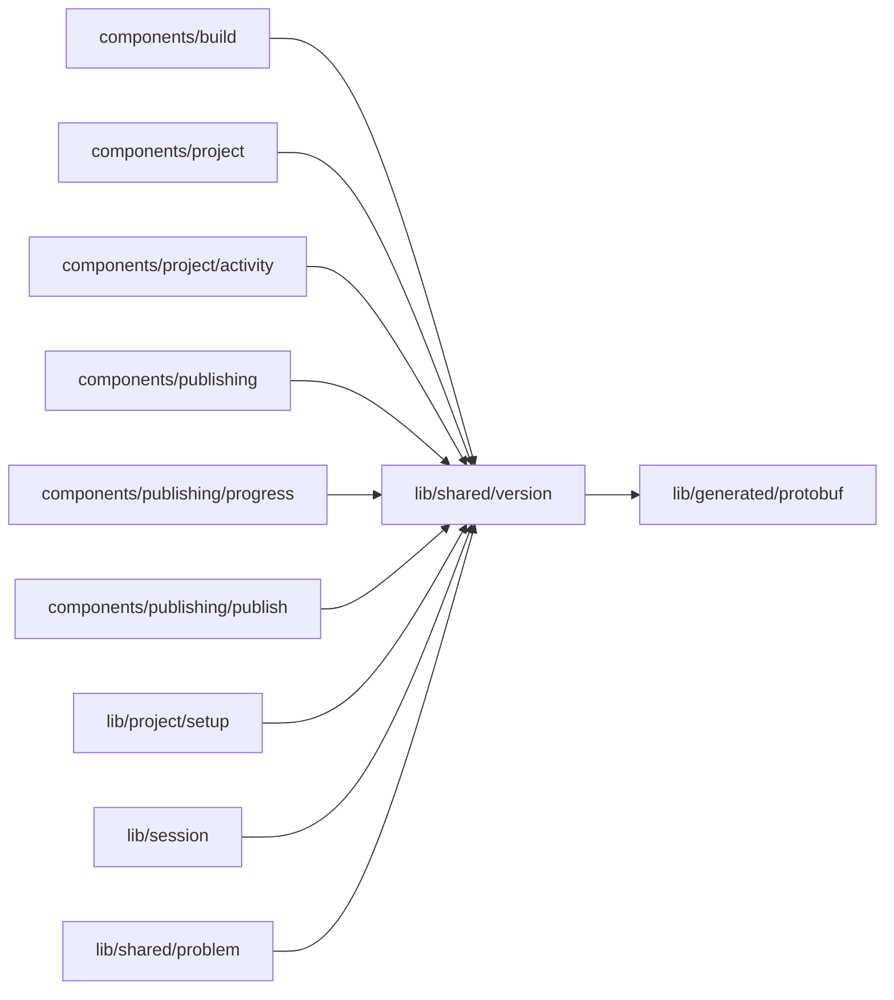

# Versions

<!-- BEGIN GENERATED DIRECTORY SUMMARY (scripts/check-readmes.mjs; edit only Purpose) -->
Purpose: How Studio names a commit: "V12 · subject" from the version the server froze with each record, never a cut hash.

Importers: `components/build`, `components/project`, `components/project/activity`, `components/publishing`, `components/publishing/progress`, `components/publishing/publish`, `lib/project/setup`, `lib/session` and `lib/shared/problem` import this directory.

Imports: it imports `lib/generated/protobuf`.

<!-- END GENERATED DIRECTORY SUMMARY -->

`versionLabel` and `versionNumber` render a `CommitVersion`; a record without one reads "Version not
recorded", and a commit not prepared yet reads "the latest push". The full hash appears only in hover
hints and folded details (`commitDetail`). ESLint forbids cutting a commit hash anywhere else.
