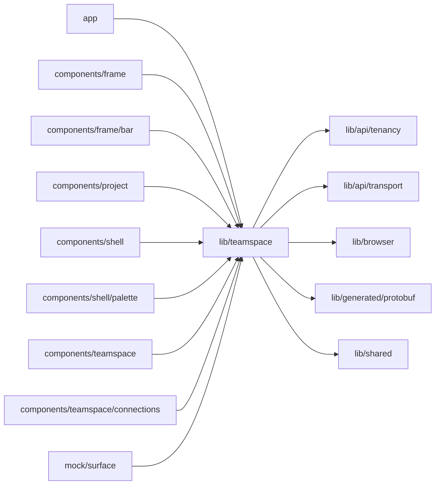

# Teamspace feature

<!-- BEGIN GENERATED DIRECTORY SUMMARY (scripts/check-readmes.mjs; edit only Purpose) -->
Purpose: The current Teamspace of the signed-in pages with its one read, the Teamspace list, and the closed sets of Teamspace and Project roles.

Importers: `app`, `components/frame`, `components/frame/bar`, `components/project`, `components/shell`, `components/shell/palette`, `components/teamspace`, `components/teamspace/connections` and `mock/surface` import this directory.

Imports: it imports `lib/api/tenancy`, `lib/api/transport`, `lib/browser`, `lib/generated/protobuf` and `lib/shared`.

<!-- END GENERATED DIRECTORY SUMMARY -->

The current Teamspace is the one a `/t/{id}` page names, else the open Project's, which its Builder reports with
`follow`, else the one last open in this browser. A read for another Teamspace, or a late one, never replaces the
current one, and an older snapshot never replaces a newer one: the read model can lag a write's answer.
