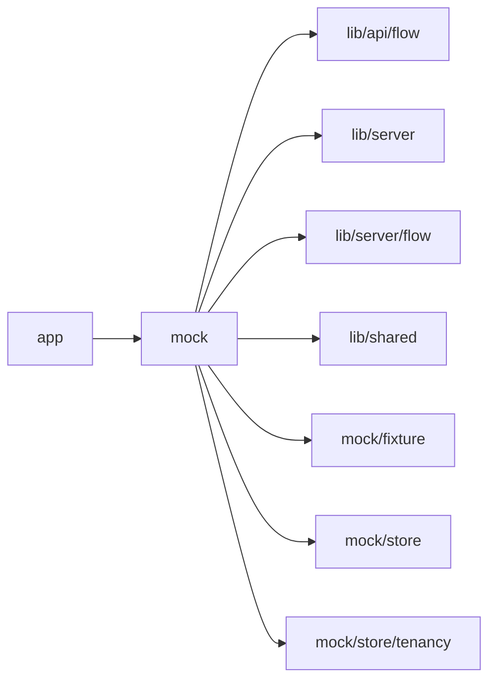

# Studio local mock

<!-- BEGIN GENERATED DIRECTORY SUMMARY (scripts/check-readmes.mjs; edit only Purpose) -->
Purpose: Mock mode for local presentation: the mock switch, the `/dex` Flow API mock and the mock application page, selected only by `app/` route files.

Importers: `app` imports this directory.

Imports: it imports `lib/api/flow`, `lib/server`, `lib/server/flow`, `lib/shared`, `mock/fixture`, `mock/store` and `mock/store/tenancy`.


<!-- END GENERATED DIRECTORY SUMMARY -->

Run the Studio UI without Local Kind, the Go server or Dex. With
`SUPERVERSE_STUDIO_MOCK=true` the route files hand `/api/rpc/<Method>`,
`/api/auth`, the workspace account read and the Session source to
`mock/backend`, an `RpcBackend` over the in-memory store, and answer the other
Studio-owned `/dex/*` routes from `flow-api-mock.ts`. The same allowlist, strict
decoder, caller check, ErrorInfo table and Server-Sent Events relay run in front
of the mock as in front of gRPC, and requests and responses cross the real
protobuf codecs, so the mock sees and returns the wire shapes Go does.

Set the variable only for this mode; production and Kind deployments leave it
unset. Then the same routes reach the real BFF, the unscoped `/dex/api/*`
fixture route answers 503 and `/api/mock-app` answers 404. Nothing in this mode
is integration or acceptance evidence.

## Layout

The mock is TypeScript typed with the generated protobuf types, so `tsc`
rejects a stale field or enum name. Only `app/` route files import it and choose
between it and the production code with `isStudioMockEnabled()` (`enabled.ts`);
`lib/` and `components/` never import `mock/`.

| Path               | Owns                                                                                                                                                                                                                                                                                                                                                                                                                                                                                                                                                                                                                                                                                                                                                       |
| ------------------ | ---------------------------------------------------------------------------------------------------------------------------------------------------------------------------------------------------------------------------------------------------------------------------------------------------------------------------------------------------------------------------------------------------------------------------------------------------------------------------------------------------------------------------------------------------------------------------------------------------------------------------------------------------------------------------------------------------------------------------------------------------------- |
| `store/`           | The in-memory store (`store.ts`), its seed data, the mock Agent's state, queue commands and Session reads (`agent-state.ts`), its scripts and their phrases (`agent-scripts.ts`), its background commands and subagents with their scripts and the Stop button (`tasks/agent-tasks.ts`), Project configuration drafts with the `/dex` Configuration routes over them (`configuration.ts`), the Agent's commits to main, Releases, builds and Live (`publishing.ts`), mock accounts and the Project, Release and Deployment snapshots (`resource-snapshots.ts`), the clock, generated IDs and the phase timings laid out on them (`clock.ts`), and the Teamspaces, their members, connections and the Projects' members with the caller's role (`tenancy/`) |
| `fixture/`         | The Flow Definition fixtures and their classification (`flow-definitions.ts`), the mock Agent's questions and requirements card (`agent-requests.ts`), the one fixture connector with its release manifest (`connector-manifest.ts`), and the Flow runs recorded from Local Kind with the Project's Flow Definitions (`flow-runs.json`, typed by `flow-runs.ts`; see [Recorded Flow runs](#recorded-flow-runs)), with two invented failed runs made from them (`failed-runs.ts`)                                                                                                                                                                                                                                                                                                                                            |
| `surface/`         | The fixture Project surface with its role lens                                                                                                                                                                                                                                                                                                                                                                                                                                                                                                                                                                                                                                                                                                             |
| `backend/`         | `mockBackend(origin)` (`mock-backend.ts`): the `RpcBackend` that answers AccountService and the ten browser services by method name (one `*-service.ts` each, and `tenancy-service.ts` for TeamSpaceService, TeamSpaceMemberService, ProjectMemberService and TeamSpaceConnectionService), with the codec round trip and the store Watches (`store-watch.ts`)                                                                                                                                                                                                                                                                                                                                                                                              |
| `flow-api-mock.ts` | The `/dex` Flow API mock: Runs reads over the recorded runs, and Configuration                                                                                                                                                                                                                                                                                                                                                                                                                                                                                                                                                                                                                                                                             |
| `mock-app.ts`      | The stand-in application page that Preview and Live URLs open                                                                                                                                                                                                                                                                                                                                                                                                                                                                                                                                                                                                                                                                                              |

## Start

```bash
cd web/studio
npm run mock
```

Open `http://127.0.0.1:3000` and register a mock account; like production,
the workspace and every business call require a signed-in account. Accounts
live only in memory until the dev server stops, and `admin@superverse.test` is an
administrator. Seed data:

- Project `Mock inbox app` (`11111111-1111-4111-8111-111111111111`)
- Failed project `Failed template app` (`33333333-3333-4333-8333-333333333333`)
- Project `Supplier onboarding` (`44444444-4444-4444-8444-444444444444`), in which a
  signed-in account has no role: the project list shows it without opening it
- Active Session (`22222222-2222-4222-8222-222222222222`) with a completed seed
  conversation; its Agent runs on `AGENT_MODEL_OPUS_5_5` (Claude Opus 5.5) at
  `medium` effort, at model revision 0. Its READY workspace is reclaimed one
  hour after the Agent last used it (`expiresAt`, the Sandbox deadline); an
  ordinary message or `show tools` moves the deadline, and `pause workspace`
  reclaims it at once. Like the server, the mock sets no inactivity deadline

## An application's own Flows

To lay out the canvas against a real application's Flows, name its analyzer FDG 2.0 files, colon-separated, in
`SUPERVERSE_STUDIO_MOCK_FLOWS`. They join the mock Project's Flow Definitions on Preview and Live, with no runs:

```bash
SUPERVERSE_STUDIO_MOCK_FLOWS=$HOME/app/build/flows/a_flow.json:$HOME/app/build/flows/b_flow.json npm run mock -- -p 3200
```

## Clock and generated IDs

Every mock time and generated ID comes from `mock/store/clock.ts`. Without
`SUPERVERSE_STUDIO_MOCK_EPOCH` the clock is the real time and Project, Session,
commit and account IDs are random, so ordinary mock use is unchanged.

Set it to an ISO time to make the mock repeatable, as the visual-regression
harness does:

```bash
npm run build
SUPERVERSE_STUDIO_MOCK=true SUPERVERSE_STUDIO_MOCK_EPOCH=2026-01-15T09:00:00Z npm run start -- -p 3301
```

- The clock starts at the epoch on its first reading, so the seed data is dated
  from the epoch, and then advances in real time in whole seconds. It is never
  frozen: the Sandbox deadline that the Agent's work moves goes forward as time
  passes.
- Generated IDs hash the epoch with a counter.
- Two mock servers started with the same epoch answer the same request sequence
  with the same bytes, apart from the login cookie, as long as each step runs
  in the same whole second since the first reading on both. Drive them from
  production builds, because a `next dev` compile can take seconds.
- The browser compares times it renders with its own clock, so install the
  browser clock at the epoch as well.
- The login expiry stays on the real clock, because it becomes the cookie's
  `Expires`, which the browser checks against its own time.

## Projects and Sessions

New project stores the request in browser storage and opens `/projects/new`,
which retries admission with the same request ID and then opens the Project.
Session admission follows the same rule; the mock remembers both admission
identities, so a retry returns the original Project or Session.

The start page creates a new private managed repository from the template, then
starts an Agent Session. Project deletion archives its managed repository.

The Project page lists Sessions by lifecycle (active, terminal, all) with Stop.

## Seeded conversation

The seed Session's conversation uses the same `components/agent` presentation as
production: milestone replies, parallel and sequential tools, a final reply, and
model, tool and turn timing from durable `startedAt` and `createdAt` with recent
activity for progress. Like the public history, a tool call carries only its
`target` and a tool result has no content, only its outcome and `durationMs`. The
work log shows each model call's metrics with the new field names: the second
call was served by Claude Sonnet 5.5 after a fallback (a `KIND_MODEL_FALLBACK`
notice line and `served by` in its metrics) and reports no thinking tokens, shown
as `unknown`; `npm test` ran two attempts (a `KIND_TOOL_PROGRESS` event carries
only the attempt number). `Load earlier` and `Jump to beginning` page archived
history. Completed Sessions show read-only history without a live-update warning
or a running clock.

## Model selector

The selector under the conversation sends `UpdateSessionModel` with the
description's `modelRevision`. The mock takes it in every Agent status, refuses a
stale revision as `AGENT_COMMAND_NOT_ADMITTED` and acknowledges an exact retry of
the change that already happened. The selected model takes effect at the next
turn: until then the model line keeps the context's model and the selector says
`Takes effect at the start of the next turn`. Sending any message then refreshes
the context (a `Context refreshed after a platform or model change` marker) and
moves `contextModel` to the selected model; Haiku reports no effort, so its model
line omits the effort.

## Mock model

Mock mode is a local environment, so `ListMockScenarios` answers every account
with `selectable` and the fixture catalog of `mock/store/scenarios/`, and the
selector lists **Mock**. A Session on it shows the mock composer instead of the
text box: a category, a scenario of it and its arguments, and a line that
names the input the scenario takes next, which Send next input sends. Both
fixture scenarios are Project features. The fixture inputs are
script phrases with their `[[scenario:name#n]]` markers, which the phrase match
ignores: `requirements-draft-changes` records the requirements card as version 1 and a
message that changes it as version 2 (the revised card leaves the marker out), and
`build-basic` runs an ordinary turn. Like the server's mock model, the mock
reports where the scenario stands (`AgentDescription.mockProgress`) after each
input, which the composer reads; a turn that waits on a timer takes a message input, which
the composer sends and steers. The question cards and the Brief of a context on the mock
model name the mock composer instead of their own controls;
The mock Agent does not check the order
of inputs; the server's mock model does.

## Script phrases

Send these exact phrases in the Session composer (trimmed, case-insensitive).
Keep this table authoritative and update it with any new mock script in
`mock/store/agent-scripts.ts` or `mock/store/tasks/agent-tasks.ts`.

| Phrase                       | Effect                                                                                                                                                                                                                                                                                                                                                               | UI to verify                                                                                                                                                                                                                                                                                                                                                                                                                                                                                                                                                                                                                                                                                                                                                                                            |
| ---------------------------- | -------------------------------------------------------------------------------------------------------------------------------------------------------------------------------------------------------------------------------------------------------------------------------------------------------------------------------------------------------------------- | ------------------------------------------------------------------------------------------------------------------------------------------------------------------------------------------------------------------------------------------------------------------------------------------------------------------------------------------------------------------------------------------------------------------------------------------------------------------------------------------------------------------------------------------------------------------------------------------------------------------------------------------------------------------------------------------------------------------------------------------------------------------------------------------------------- |
| _(open seed Session)_        | The completed seed conversation                                                                                                                                                                                                                                                                                                                                      | Quiet conversation and one collapsed Work log with timing                                                                                                                                                                                                                                                                                                                                                                                                                                                                                                                                                                                                                                                                                                                                               |
| `show tools`                 | A `Context compacted` marker, a gap in the history sequences, another full set of tool calls (the long command fails) plus one pending `glob`                                                                                                                                                                                                                        | A divider line with the marker text, never a chat bubble; compact work log rows (name, target, status and duration, with no output or arguments); the pending call's row says running                                                                                                                                                                                                                                                                                                                                                                                                                                                                                                                                                                                                                   |
| `ask questions`              | An assistant `request_user_input` call and three pending questions with long headings and options                                                                                                                                                                                                                                                                    | The question panel above the composer scrolls only its body; the history card shows only the first question, and after answering its status reads answered                                                                                                                                                                                                                                                                                                                                                                                                                                                                                                                                                                                                                                              |
| `confirm requirements`       | An assistant `confirm_requirements` call, recorded at once as the next version of a card with two features and two connections, one existing and one new; a todo list and a reply that the agent builds it                                                                                                                                                           | Nothing waits: its Flow design (`ReleaseNewsletterFlow`) shows on the Flow tab as the Process Brief badged `Building from this brief · version 1`: a summary grid (what starts it, who acts, the rules, the apps) above the design drawn left to right, with the rest behind More details, at once when the Flow tab is open and with a Design marker on its tab otherwise; the chat shows a collapsed What the agent builds disclosure. While the card is unbuilt, which the mock never finishes, any other message, or the Brief's Change something…, records version 2 with the change as one more feature; the design stays `Design · building`                                                                                                                                                     |
| `confirm plain requirements` | The same card without a Flow design                                                                                                                                                                                                                                                                                                                                  | The Flow tab shows the Process Brief's summary grid alone under the note that the agent's last turn ended before the processes were built                                                                                                                                                                                                                                                                                                                                                                                                                                                                                                                                                                                                                                                               |
| `need approval`              | A pending tool approval                                                                                                                                                                                                                                                                                                                                              | Approval card with a `tool call:` kicker and the opaque arguments JSON                                                                                                                                                                                                                                                                                                                                                                                                                                                                                                                                                                                                                                                                                                                                  |
| `tool failed`                | A `grep` call that fails for a platform reason, and the reply that carries on                                                                                                                                                                                                                                                                                        | A compact work log row for the failed call with its code `tool_error`; no recovery panel                                                                                                                                                                                                                                                                                                                                                                                                                                                                                                                                                                                                                                                                                                                |
| `show todos`                 | An Agent todo list of three items, one completed and one in progress                                                                                                                                                                                                                                                                                                 | Read-only progress line `Progress 1/3: Add search and tags` below the conversation                                                                                                                                                                                                                                                                                                                                                                                                                                                                                                                                                                                                                                                                                                                      |
| `pause workspace`            | Stands in for the Sandbox deadline passing while the Session is idle: the workspace instance closes with its files kept and its Preview stops. The next ordinary message, `show tools` or **Prepare current source** starts a new instance with a new workspace request ID and moves the deadline one hour ahead                                                     | The Build tab shows `Paused` and the chat reads `Paused; your files are kept`; afterwards the Build tab shows the time left until the workspace is reclaimed                                                                                                                                                                                                                                                                                                                                                                                                                                                                                                                                                                                                                                            |
| `run in background`          | A `bash` call whose command runs on as a background task                                                                                                                                                                                                                                                                                                             | The Background tasks panel lists `Run the test suite` as Running, and the Stop button and `Esc to stop` appear beside the composer                                                                                                                                                                                                                                                                                                                                                                                                                                                                                                                                                                                                                                                                      |
| `finish task`                | The oldest running background task exits with code 0: a task notification and an automatic turn's reply                                                                                                                                                                                                                                                              | A `Background task finished` notice (never a user bubble) with the summary, the reply after it, and the task under `finished` in the panel                                                                                                                                                                                                                                                                                                                                                                                                                                                                                                                                                                                                                                                              |
| `start subagent`             | A `start_agent` call: an `investigate` subagent runs on in the background, with one live status line on the Watch                                                                                                                                                                                                                                                    | The Background tasks panel lists `Investigate how the inbox loads messages` with `investigate` as Running and `Running grep.` below it; the Stop button appears beside the composer                                                                                                                                                                                                                                                                                                                                                                                                                                                                                                                                                                                                                     |
| `finish subagent`            | The oldest running subagent completes with two changed files: a task notification and an automatic turn's reply                                                                                                                                                                                                                                                      | A task notice with the summary, the reply after it, and the subagent under `finished` in the panel with `2 files changed (+14 −3)`                                                                                                                                                                                                                                                                                                                                                                                                                                                                                                                                                                                                                                                                      |
| _(Stop or Esc)_              | While a turn waits (for example after `need approval`), a background task or a subagent runs, `InterruptAgent` with the Snapshot's turn: the waits end, every running task stops with no notification (the mock leaves out the stopped report a real subagent sends). A Stop of an earlier turn, or with nothing running, is refused as `AGENT_COMMAND_NOT_ADMITTED` | `Stopped by user` and `Automatic continuation paused; reply to continue` markers; the stopped task reads Stopped                                                                                                                                                                                                                                                                                                                                                                                                                                                                                                                                                                                                                                                                                        |
| `fail live deployment`       | Stands in for a Live deployment of the Session's HEAD that fails in a phase the application owns, as in the server scenario `live-failure-fix`: a delivery notification and an automatic turn that reads the delivery status, pushes a fix and asks the user to publish it                                                                                           | A `Live deployment failed` notice (never a user bubble) with `DEPLOYMENT_FAILED`, the short commit, `Caused by the application`, a collapsed Details message and **Open the Deployment**; the reply after it, and the fix's commit handled like any other push                                                                                                                                                                                                                                                                                                                                                                                                                                                                                                                                          |
| `fail live build`            | Stands in for a Live build of the Session's HEAD whose outcome the build provider never reported: a platform notice and no turn                                                                                                                                                                                                                                      | A `Live release did not complete` notice with `BUILD_UNKNOWN`, `Platform problem, not caused by the application`, **Open the Release** and **Configure the Release**; no reply                                                                                                                                                                                                                                                                                                                                                                                                                                                                                                                                                                                                                          |
| `fail preview start`         | Stands in for a Preview start of the Session's HEAD that fails at its configuration, whose server-declared remedy is Open Setup                                                                                                                                                                                                                                      | The Preview tab turns red with the word `failed`, whose hint reads `failed: Starting the Preview needs configuration` and which opens the Interface; there the problem panel shows **Open Setup** and the folded code and phase; no reply                                                                                                                                                                                                                                                                                                                                                                                                                                                                                                                                                               |
| _(any other message)_        | User message, a completed `glob` and a commit pushed to main, which the Preview deploys while **Update the Preview after every push** is on: a validated Preview configuration serves it at once; any other lacks the fixture requirement `default (configuration incomplete)`                                                                                       | One compact `glob` row with the target `*` in the collapsed work log; Tools, Publishing, Config lists the new commit with the message as its subject. With a validated configuration the Interface's Preview panel reads `Deployed …` and `Preview is at X, HEAD is X (up to date)`; otherwise a `Preview needs configuration` notice with the gap and **Configure Preview**, once for the same gaps, and the panel lists the gap                                                                                                                                                                                                                                                                                                                                                                       |

## The Builder

`/p/{project}/{surface}` draws the Builder frame of the production page
(`components/frame`): the sidebar, the 48px bar with Preview | Live, the
Project's chat in its column and the surface's content. The chat column and
the sidebar fold to rails when dragged narrow, and their widths are remembered
in the browser. Mock Setup completes at once, so a new mock Project is READY
with its Session, which starts on the model chosen on the creation page with its
first message, which CreateProject carries, as in production; the creation
page offers the mock model, whose composer takes a scenario's first input, and
preselects it for `admin@superverse.test` and Sonnet for any other mock account. A
Project whose Setup failed has no Session. "Keep running for 7 days" behind the
chat header's workspace timer moves the READY workspace's deadline seven days ahead and answers that
a paused workspace is not running, as Go does.

Publish in the bar works over the mock store: the first publish of a commit
stops at "needs Live configuration" with a link to Setup's Next publish column for that commit
(select its connection there), and the next one prepares, builds and deploys it Live with
the mock's automatic deployment.

The bar's Preview and Live tabs each show one status dot, and a word only when something is off. A configuration is READY
once it has no gap, as Go reports on every read; the fixture's gap is the
connection until a Teamspace connection is selected. Every Setup edit autosaves
(the bar says Saving…, then Saved), and a write on a revision another tab
changed shows "Changed elsewhere" on the item with Keep yours or Take theirs.
Setup applies a running Preview's saved changes on its own three seconds after the last edit, and Apply to
Preview does it at once: either freezes the revision the tab last saved and restarts the Preview. While it
waits the line reads "Updating Preview with N changes…"; a stopped Preview's changes count as "N changes not
on Preview yet" and mark the Tools tab and its Setup entry with "Setup needs you", and Start applies them. An
Apply after another tab changed Setup is refused with `PREVIEW_CONFIGURATION_CHANGED`. A push revalidates the
applied configuration instead of applying. Switch to Live to see the "N behind" count in
the Live tab's hint, the Live chip and the chat's Live note.

Tools, Setup (`?tool=setup`) shows one table with a Preview column and a Next publish column, Live's
next-publish layer, where every item follows what Preview applied until Live sets its own, and Same as
Preview follows again; a secret and a connection tied to one address are always Live's own. With `v=live`
it shows the Next publish controls alone under a dark banner, with what waits for a publish under Live's
name; the bar's Publish opens the Publish popover on Live's own version there, and on the newest version
on the Preview tab. Setup applies Preview's saved changes on its own; there is no Apply button. Publishing builds the version's copy from the layer
(`DeriveLiveConfiguration`). Named fixtures seed more of Setup and of the Publish popover through the page
URL, once per mock server and cumulatively, so restart the mock to see one alone:

- `?setupFixture=first-publish`: Preview applied the seed connection and a label and ran the seed head,
  so the Publish popover shows it "ran on Preview" and every Live item following Preview.
- `?setupFixture=evicted-start`: as `first-publish`, then fifty starts of another commit push the head's
  start out of the bounded record, so the head reads "not in the Preview record" and publishes only
  with a written reason.
- `?setupFixture=later-publish`: Live runs the older main commit, with a model and an environment
  value the newer commit no longer declares; Live's next publish follows Preview except for its own
  model (`gpt-4.1`), which waits for the next publish, with Same as Preview; `MOCK_TOKEN` is Live's own
  secret and `LEGACY_GREETING` is no longer used. The head ran on Preview; the older commit's build was
  published with a skip reason. The Publish popover on the Live tab (`?v=live`) publishes Live's own
  version again with its waiting settings.
- `?setupFixture=build-failure`: as `later-publish`, with Live's own `MOCK_BUILD_OUTCOME` `failed`, so
  a publish ends in a failed build shown as a problem under the stage bar.
- `?setupFixture=slack`: Setup gains a Slack connection name `support` (select "Support
  workspace") with a start and a reply trigger. Its channel list includes `#general`, which the app is
  not in, with how to invite it; picking the start channel fills the reply channel; `#support` is also
  listened to by another Project, which the item's warning names.
- `?setupFixture=next-publish`: Setup opens on the prepared head; Preview applied the seed connection, a
  label and the Slack connection name listening in `#escalations`, and Live runs the head with exactly the
  next publish: every item follows Preview and nothing waits. Slack's Next publish channel is where Preview
  listens too, which its menu note and the Publish popover's Check say without colouring it.
- `?setupFixture=waiting`: as `next-publish`, then Preview applies a new label, which the next publish
  follows, and the next publish has its own model: two settings wait, each with a blue dot whose hint
  names what Live V1 runs, and the Live tab's banner counts them.
- `?setupFixture=endpoint-bound`: as `next-publish`, with a Stripe connection name `payments` that Preview
  selects ("Stripe test mode"); Stripe is tied to one address, so the Next publish dropdown has no Same as
  Preview, says why in its menu note and stays red ("Needs its own") until Live has its own; New connection…
  opens the form in the row with Live's address. On the Live tab it arrives with the next publish.
- `?setupFixture=narrow`: `waiting` and `endpoint-bound` together, with the tools drawn 620px wide, so
  Setup's rows show their Preview and Publish chips and open to their controls. A window narrower than
  about 1100px stacks the cells instead.
- `?setupFixture=try-it`: Preview runs the prepared head with nothing connected, Runs and Inbox hide the
  recorded runs and the catalog offers starts, so Runs on Preview opens on Try it: the fixture connection to
  set up in place, then the start form. A start copies the waiting recorded run under the new Flow ID, which
  the canvas then shows; the same request ID recovers it.

- **Flow** (`/flow`) opens on the project map of the fixture catalog, one card
  per Flow Type with its Steps and who acts; a card, or the process picker at
  the head of the tabs (`?flowType=`), opens that Flow's canvas, as production
  does with the prepared source's definitions. The picker lists the Processes
  of the prepared Preview source, which the mock lacks until it is prepared.
- **Runs** and **Inbox** read the fixture catalog (below). Under All processes
  the list merges every Flow Type's runs; a selected run is drawn whole with
  its waiting Step ringed "now", and clicking a Step opens the drawer with its
  Actions, Open in Inbox, Time travel, Ask the agent (which puts the run and
  Step in the composer as a chip) and Stop. The list folds to a rail of status
  icons with ‹ or by dragging.
- **Interface** frames the Project's Preview under an address bar with reload,
  open in a new window and Stop, with Start Preview in place while it is
  stopped, after the source is prepared and its configuration validated; on
  Live it frames the Live address the same way, with copy link, and both fold
  their details under Details. The Preview and Live URLs are the same-origin
  `/api/mock-app`, so the browser URL probe succeeds. Under the application, **Update the Preview after every push**, on
  for a new Session, answers `UpdatePreviewAutoDeploy` with the Session's ACTIVE
  check; while it is off, a pushed commit is not deployed. Until the Preview
  configuration is validated, Configuration and the Preview panel list its one
  fixture gap.
- **Tools** lists Publishing, Connectors, Permissions and Configuration, folds
  to a rail of icons, and pins any tool as a tab (the row's pin, or + after the
  tabs). Publishing shows Live, then the mock's versions with Live's marked,
  Roll Live back for an older one, and each version's builds, one line each
  that opens to the rest, and Live's history in the same rows. Connectors opens the fixture's
  one connection in place with Preview and Live alike; "Use Preview's
  connections on Live" prepares the next version when it is not yet and opens
  Live's connection filled in from Preview, and the Live fixture credential is
  already stored.
  Configuration edits the Preview's application environment of the source
  prepared for the Session's HEAD with the native controls; like Go, opening
  either prepares nothing, and an unprepared HEAD reads "Prepare the current
  source".

The earlier URLs `/build` and `/publishing` redirect to the Flow, the
Interface (`?buildView=preview`), Configuration (`?buildView=configuration`)
and Tools, Publishing.

Home (`/`) lists the mock Projects as cards with New project (`/projects/start`);
⌘K opens Jump to. In a Project, the composer's picker button turns the next
click on a Step, run or Process into the message's "About" chip, `/` focuses
the composer, and Escape cancels picking.

## Publishing

Tools, Publishing is Live-only and needs no Session. It lists the Project's newest 100 main-branch
commits with each Release's builds and how each met the Preview rule; **Current Live** shows what
Live serves and **Stop Live…** removes it after a confirmation. Publishing happens in the bar's
**Publish** popover: the mock's `StartReleaseBuild` admits a build like the server, for the code Live
runs, a READY Preview start of the commit (the mock Agent's pushes record one) or a written skip
reason, and refuses `PREVIEW_VALIDATION_REQUIRED` otherwise. An older version with a build rolls Live
back, after a confirmation that states which version and build will run.

To see a failed build, use `?setupFixture=build-failure` or set the environment field
`MOCK_BUILD_OUTCOME` to `failed` in Setup's Next publish column before publishing.

A build Studio starts, and a rollback, run on the clock (`store/delivery/publish-runs.ts`), moved on
every read of the store: Lock settings 2.5 s, Build 16 s, then the automatic deployment's Deploy 9 s and
Go live 4.5 s, so Tools ▸ Publishing shows each stage of the bar in turn. The build log grows a line
about every second while it builds (one line shows a redacted value), and is complete once the build
ends. Cancel works as on the server: `CancelReleaseBuild` cancels a building build (CANCELLED three
seconds later), refuses one whose deployment is admitted with `RELEASE_BUILD_DEPLOYING`, its remedy and
the `deploymentId`, and any other with `RELEASE_BUILD_NOT_CANCELLABLE`; `CancelDeployment` cancels a
deployment until its health check passed (CANCELLING, then CANCELLED with its cleanup) and refuses
later with `DEPLOYMENT_NOT_CANCELLABLE`. Live never changes until a deployment goes live. Live's
history lists these publishes, cancelled ones as `PUBLISH_CANCELLED`, beside a seeded rollback, a
seeded cancelled publish and the seeded publish of the older commit. The frozen copy's
`MOCK_BUILD_OUTCOME` decides the end: `failed` fails the build, `unhealthy` fails the health check, and
anything else goes Live. Fixture builds seeded by `?setupFixture=` still settle at once.

`?publishFixture=` seeds one publish of the seed head over `later-publish`, so each state can be seen
without waiting; asking for another starts it over: `ready` (nothing yet, the head ahead of Live),
`locking`, `building`, `deploying` and `going-live` (held in that stage), `published`, `failed` (its
health check), `build-failed`, `cancelled-build`, `cancelled-deploy` and `rollback` (Live back to the
older commit, held in Deploy).

## Runs, Inbox and fixtures

In production, Runs and Inbox read the Project's running Preview (`?v=preview`)
or the Release Live serves (`?v=live`). In mock mode both read the fixture
catalog at `/dex`: the mock Project is a template Project whose Agent added a
summary approval, so its one Flow Type is `TextSummaryFlow` with the Step
`AwaitSummaryApproval` and the Action **Approve summary**. Its two
[recorded runs](#recorded-flow-runs) never change: one completed, and one waits
for **Approve summary**. Two invented failed runs follow them (`fixture/failed-runs.ts`),
made from the completed one: in the first, **Generate summary** failed into its
failure route, **Record summary uncertainty**, and the run completed; in the
second, **Save summary result** failed on its third try with no failure route and
the run ended as failed. Every Flow mutation, Stop and Time travel included,
answers 403.

| Query                              | Effect                           | UI to verify                                                                                                                                                                                                                                                                                 |
| ---------------------------------- | -------------------------------- | -------------------------------------------------------------------------------------------------------------------------------------------------------------------------------------------------------------------------------------------------------------------------------------------- |
| _(none)_                           | Select the first valid Flow Type | The Flow draws `TextSummaryFlow` with its approval; Runs lists the waiting run under Open and the completed and failed runs under Closed; a failed run's drawer leads with what happened and what happens now; Inbox lists the waiting run, whose drawer offers **Approve summary**; Diagnostics of a recorded run renders Overview, Execution graph, Timeline and Streams |
| `?flowType={type}`                 | Select a valid Flow Type         | The Flow and Runs render only that definition                                                                                                                                                                                                                                                |
| `?flowType=FlowFromAnotherApp`     | A Flow Type absent from this App | The Flow and Runs fail closed and draw nothing                                                                                                                                                                                                                                               |
| `?fixture=customer-refund-agentic` | Schema 2.0 with four Actions     | Inbox shows its work list: the waiting recorded run, because `/dex` always serves the Project's catalog                                                                                                                                                                                      |
| `?fixture=customer-refund`         | Schema 2.0 with zero actions     | Inbox says nobody is asked to do anything                                                                                                                                                                                                                                                    |
| `?fixture=user-onboarding-process` | Schema 1.0                       | Runs and Inbox show an older-format state; the Flow still draws it                                                                                                                                                                                                                           |
| `?fixture=force-error`             | The definition fails to load     | The error state with a quotable identifier                                                                                                                                                                                                                                                   |
| `?role=owner\|builder\|operator`   | The role lens                    | The surfaces the registry opens to that role, the chat only for an owner or builder, Live only for an operator, and the role word in the bar; never authorization. Without it the frame shows the account's role in the Project: owner of the ready seed Project, operator of the failed one |
| `?v=live`                          | Select Live in the bar           | Every surface follows it and the link keeps it; it never switches back by itself                                                                                                                                                                                                             |

Tools, Permissions states who can open the Project today. The four not-ready
states are deliberately distinct in wording and register.

## Mock routes

Open a mock Project's Build Configuration with
`?buildView=configuration&configurationReadFailures=1` to make its next valid
configuration read return 503 and recover automatically. Use `4` instead to
exhaust all four attempts and show **Retry configuration**; its next read succeeds.
Values from 1 through 4 are accepted and armed only once per Project until the
dev server restarts. Precondition failures do not consume the fixture, and writes
never consume or repeat it. The field is development-only and absent from snapshots.
This fixture is presentation coverage, not real-dependency verification.

`mock/backend` answers every RPC of the browser services and AccountService
with the checks Go makes: a stale Preview, Session, Project, Live or
configuration revision is 409, and so is a Preview command without the
instance every mock Preview acquired; an incomplete Preview observation or a
missing `messageId` is 400, and an Agent command it does not take is
`AGENT_COMMAND_NOT_ADMITTED`. `flow-api-mock.ts` answers the Flow API reads below.

| Path                                                                                              | Method | Mock answers                                                                                                                                                                                                            |
| ------------------------------------------------------------------------------------------------- | ------ | ----------------------------------------------------------------------------------------------------------------------------------------------------------------------------------------------------------------------- |
| `/dex/api/flow-definitions`                                                                       | GET    | The recorded `TextSummaryFlow` definition                                                                                                                                                                               |
| `/dex/api/v2/catalog`                                                                             | GET    | The same Flow Type with the same `definitionRevision`                                                                                                                                                                   |
| `/dex/api/v2/search`                                                                              | POST   | The recorded runs of the Flow Type, newest first, kept by `workQueueOnly` (an eligible Action) and the status (one or `in` several), start time, close time, Flow ID and indexed attribute filters; this POST is a read |
| `/dex/api/flows/summary`, `/dex/api/flows/history`, `/dex/api/flows/state`, `/dex/api/v2/display` | GET    | The named run's recorded document; an unknown run is 404 as in Go, and the completed run has no state                                                                                                                   |
| `/dex/api/flows/wait`, `/dex/api/flows/stream`                                                    | GET    | Nothing new: 408 after the Flow API's 30-second server window, before Studio's 35-second browser backstop                                                                                                               |
| `/dex/api/blobs/load`                                                                             | POST   | The recorded stored Value blobs                                                                                                                                                                                         |
| `/dex/api/v2/start`, `/dex/api/v2/start/recover`                                                  | POST   | With `?setupFixture=try-it`, a copy of the waiting recorded run under the requested Flow ID, and the same run for the same request ID; otherwise 404                                                                    |
| `/dex/api/flows/stop`, `/dex/api/v2/actions`                                                      | POST   | 403                                                                                                                                                                                                                     |
| `/dex/api/v2/display`                                                                             | PATCH  | 403                                                                                                                                                                                                                     |

Configuration uses the same native components and scoped routes as
production, below `/dex/projects/{project}/configuration/live/releases/{commit}`
or `/dex/projects/{project}/configuration/preview/{session}`:

| Path below the configuration scope                                                                | Method      | Mock answers                                                                     |
| ------------------------------------------------------------------------------------------------- | ----------- | -------------------------------------------------------------------------------- |
| `api/v2/connector-connections`                                                                    | GET         | The OpenAI fixture connection, its operation use and credential-presence markers |
| `api/v2/connector-connections/openai/default`                                                     | PUT, DELETE | Save settings and credential markers, or clear the markers                       |
| `api/v2/connector-native-sessions`                                                                | POST        | A fixed manifest and a scope-specific nonce                                      |
| `api/v2/connector-ui-sessions/{nonce}/commands/listModels`                                        | POST        | A fixed model list; no provider request                                          |
| `api/v2/connector-use-configurations/openai/default/generateText/TextSummaryFlow/GenerateSummary` | PUT         | Save the operation's model with revision checks                                  |
| `api/v2/application-environment`                                                                  | GET, PUT    | Ordinary values and write-only secret-presence markers                           |

Credential values are discarded; only configured field names are kept. Live
commit configurations share fixture credentials, and Preview credentials are
per Session. OAuth and undeclared provider commands are unavailable.

## Recorded Flow runs

`fixture/flow-runs.json` is what the Flow API answered Studio on Local Kind,
sanitized, and `fixture/flow-runs.ts` types it with the `lib/api/flow` document
types, because these are Dex JSON documents rather than protobuf. It holds the
moment a second run waited for approval:

- the Project's Flow Definitions: the template's `TextSummaryFlow` after the
  Agent added `AwaitSummaryApproval`, the Channel `SummaryApprovals` and the
  Action `ApproveSummary`. Releases and Preview sources carry them too;
- run A, **Completed**: the E2E summary text, approved as soon as it waited;
- run B, **Running** at `AwaitSummaryApproval` with `ApproveSummary` eligible:
  a 1.5 KiB invented library notice;
- for each run its summary, search row, Display and whole history, B's live
  state, and every stored Value blob these documents reference.

The mock serves them at its own time: every recorded time moves by the same
whole number of seconds, keeping its fractional digits, so that the recording
moment falls when the [mock clock](#clock-and-generated-ids) started. With
`SUPERVERSE_STUDIO_MOCK_EPOCH` set, the recorded runs are therefore read at the
epoch and their times are the same on every server.

Recording (2026-10-06, Local Kind at the PR-B head):

1. With `sv2 kind ports` running in the cluster owner checkout, a scratch
   Playwright spec outside the repository drove Studio at
   `http://localhost:23000` through `tests/e2e/support`: `register` a fresh
   account, `createProject` with `APPROVAL_PROMPT` from
   `template-approval.spec.ts`, `waitForCompletedTurn`, then
   `configure(page, "Preview", fillTemplateSummaryConnection)` with
   `SUPERVERSE_E2E_OPENAI_FILE` given by path, and `startPreview`.
2. Run A: Start Flow in Runs, wait for `awaiting-approval`, press
   **Approve summary** in the run drawer, wait for `completed`, then open its
   Diagnostics and every tab, selecting each Timeline event.
3. Run B: Start Flow with the library notice and, while it waited, open Runs (no
   selection, A, B), Inbox (no selection, B), Diagnostics of B (every tab,
   every Timeline event, one history wait, a read of the Stream
   `summary-progress`, which the Flow does not declare) and Diagnostics of A.
4. Read one history wait and one Stream read directly, approve B, wait for
   `completed`, reopen Runs and B's Diagnostics, and delete the Project.
5. `page.on("requestfinished")` and `page.on("requestfailed")` recorded every
   Runs exchange below the Preview Runs route of the Project (then
   `/dex/projects/{project}/environments/preview/sessions/{session}`);
   Configuration routes, which carry credentials, were never recorded.
6. A scratch script took the documents read while B waited and sanitized
   them: Flow, run, Start request, blob, provider call, response and request,
   and Channel message IDs became stable fakes of the same shape; the Preview
   namespace became `sv2-session-mock-mock0001`; the definition revision became
   `mock-revision-1`, which the mock catalog serves, so both runs stay bound
   to the current definition; both model summaries became fixed text and the
   provider's rate-limit headers generic values. Each definition's digest is
   the SHA-256 of its compact graph JSON, as `appmanifest` computes it. The
   script failed if any recorded identifier or summary survived. Apart from
   that namespace, the documents held no email, Project or Session ID, URL,
   token or CSRF value.

When these fixtures were recorded, every history wait and Stream read ended at Studio's
35-second request bound without an answer, and the direct reads ended after
35.3 seconds with 504 or 499 from the BFF's call deadline, before Dex's
50-second history wait window. Those observations describe the recording baseline.
The mock's idle window now follows the current Flow API contract: 408 after
30 seconds, with the browser's 35-second bound retained as a backstop. Fixture
history and state payloads do not change with this read-window correction.

To re-record, repeat these steps against Local Kind and rebuild
`fixture/flow-runs.json` with the same sanitizing rules.

## Coverage rule

A Studio change that adds or changes a page, operation or API call updates
`mock/` so `npm run mock` still exercises it, and updates this guide
when it adds a script phrase or changes a mock route.
