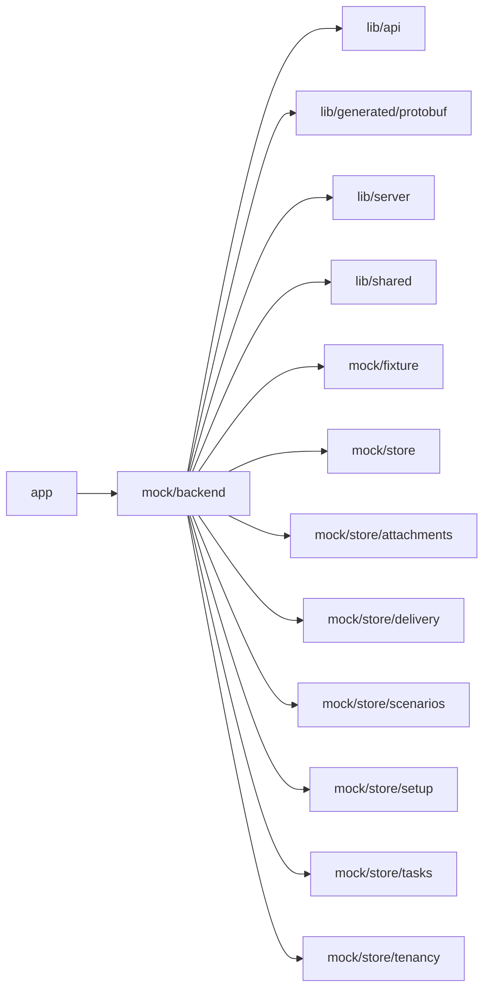

# Mock backend

<!-- BEGIN GENERATED DIRECTORY SUMMARY (scripts/check-readmes.mjs; edit only Purpose) -->
Purpose: Provides explicit development business-service fixtures through generated protobuf codecs and store Watches, without production fallback or acceptance evidence.

Importers: `app` imports this directory.

Imports: it imports `lib/api`, `lib/generated/protobuf`, `lib/server`, `lib/shared`, `mock/fixture`, `mock/store`, `mock/store/attachments`, `mock/store/delivery`, `mock/store/scenarios`, `mock/store/setup`, `mock/store/tasks` and `mock/store/tenancy`.

<!-- END GENERATED DIRECTORY SUMMARY -->

The typed `RemoteAgentService` fixture lives with Agent services, and the
`EvolveService` fixture with the deployment service (`deployment-service.ts`,
over `mock/store/delivery/goal-measurement.ts`), to preserve the backend's
ten-file limit. Builders may create ten-minute codes, list and remove
up to six dialog records per Project; operator access is refused. A weak store
key releases this state with the development store. Its endpoint is the reserved
`http://remote-agent.invalid` origin: development mode implements no remote bearer
listener, redemption, active executor or provider connection. Codes are generated
only for dialog interaction and are not retained or logged. Real Bridge pairing
and executor acceptance require the ordinary real-dependency local lanes.
