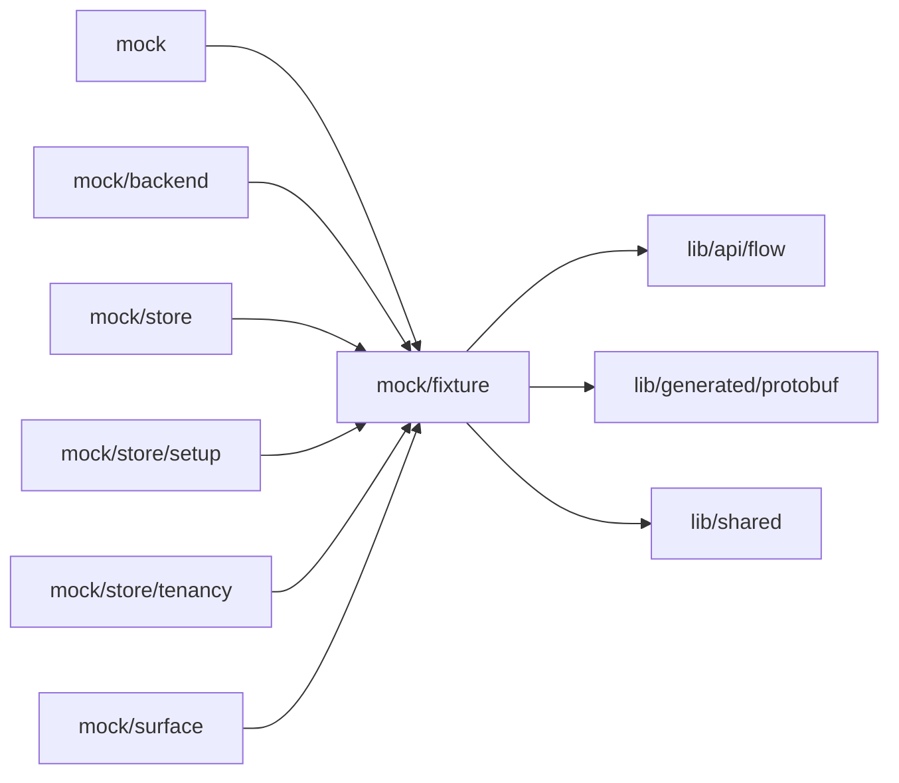

# Mock fixtures

<!-- BEGIN GENERATED DIRECTORY SUMMARY (scripts/check-readmes.mjs; edit only Purpose) -->
Purpose: The Flow Definition fixtures of mock mode and their classification, the Flow runs recorded from Local Kind that the `/dex` mock serves, and the mock Agent's questions and requirements card.

Importers: `mock`, `mock/backend`, `mock/store`, `mock/store/setup`, `mock/store/tenancy` and `mock/surface` import this directory.

Imports: it imports `lib/api/flow`, `lib/generated/protobuf` and `lib/shared`.

<!-- END GENERATED DIRECTORY SUMMARY -->
