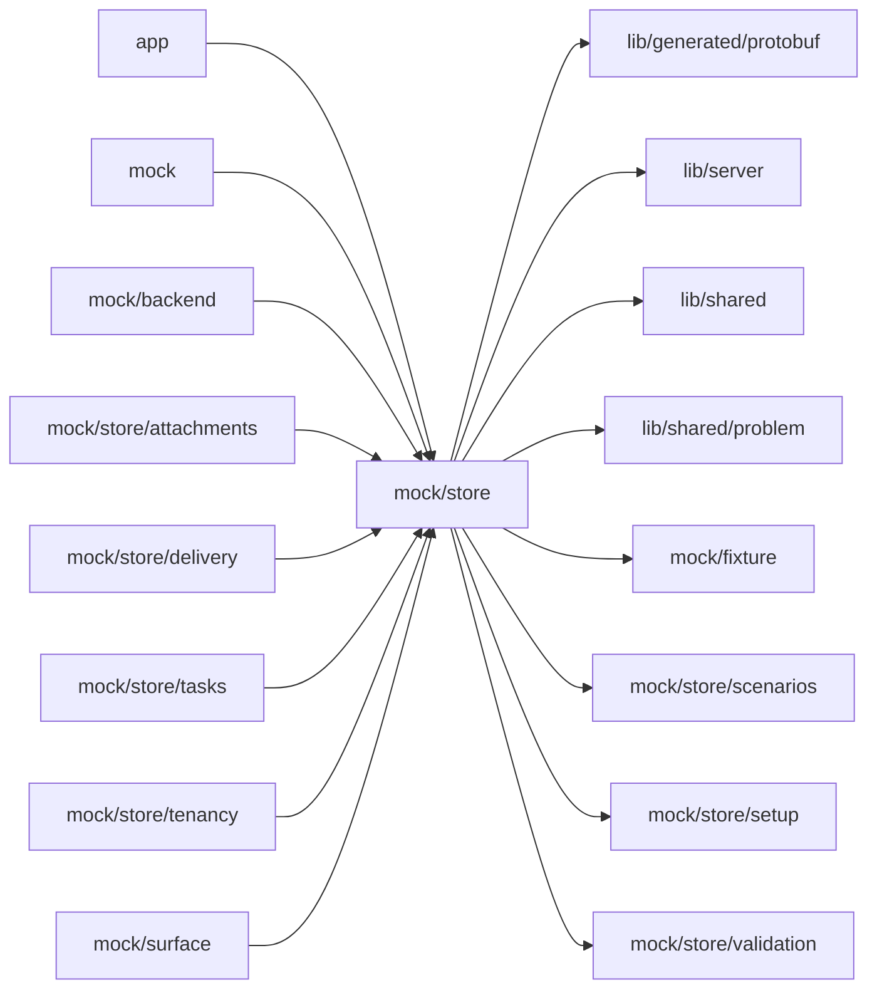

# Mock store

<!-- BEGIN GENERATED DIRECTORY SUMMARY (scripts/check-readmes.mjs; edit only Purpose) -->
Purpose: The mock's in-memory store and its clock: seed data, accounts, the mock Agent's state and scripts, configuration drafts, Releases, builds and Live, phase timings and resource snapshots.

Importers: `app`, `mock`, `mock/backend`, `mock/store/attachments`, `mock/store/delivery`, `mock/store/tasks`, `mock/store/tenancy` and `mock/surface` import this directory.

Imports: it imports `lib/generated/protobuf`, `lib/server`, `lib/shared`, `lib/shared/problem`, `mock/fixture`, `mock/store/scenarios`, `mock/store/setup` and `mock/store/validation`.

<!-- END GENERATED DIRECTORY SUMMARY -->
