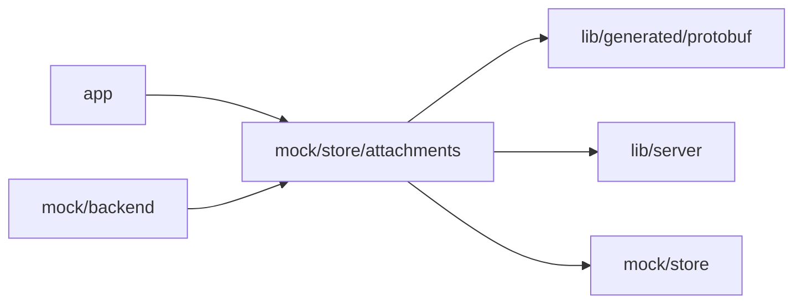

# Mock attachments

<!-- BEGIN GENERATED DIRECTORY SUMMARY (scripts/check-readmes.mjs; edit only Purpose) -->
Purpose: Development-only attachment staging, where uploads PUT to the mock route are prepared at once and the attachments a Project's messages carry have downloads.

Importers: `app` and `mock/backend` import this directory.

Imports: it imports `lib/generated/protobuf`, `lib/server` and `mock/store`.

<!-- END GENERATED DIRECTORY SUMMARY -->
