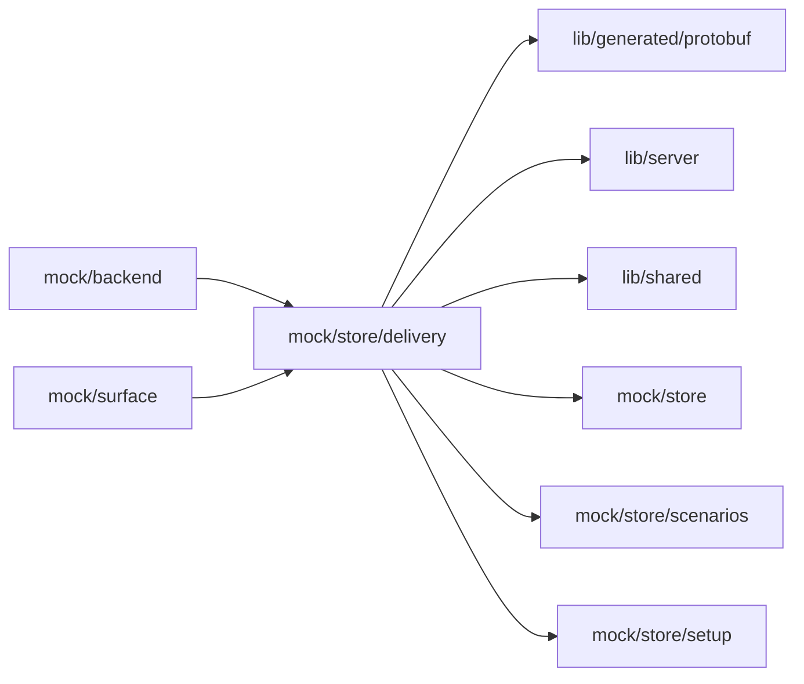

# Mock delivery feedback

<!-- BEGIN GENERATED DIRECTORY SUMMARY (scripts/check-readmes.mjs; edit only Purpose) -->
Purpose: Live delivery in Studio mock mode: publish runs, environment events, the Agent's delivery feedback phrases and the goal measurement of Live runs.

Importers: `mock/backend` and `mock/surface` import this directory.

Imports: it imports `lib/generated/protobuf`, `lib/server`, `lib/shared`, `mock/store`, `mock/store/scenarios` and `mock/store/setup`.

<!-- END GENERATED DIRECTORY SUMMARY -->

`delivery-scripts.ts` answers the delivery [script phrases](../../README.md#script-phrases)
(`fail live deployment`, `fail live build`) before the ordinary scripts of `mock/store`. A Live
deployment that fails in a phase the application owns is a `failure` notice that opens an
automatic turn, which reads the delivery status, pushes a fix and asks the user to publish it; an
unfinished build is a platform `notice` that only notifies. No Release, build or deployment runs;
the server's hooks are in `internal/dexai/delivery/releases` and `internal/dexai/delivery/deployments`.

`goal-measurement.ts` answers EvolveService for a Project with a Live deployment (NOT_FOUND before one, as the
server does): example goals of an invented outreach application (a reply rate with a target, a rate on few runs, a
guardrail that holds and an AI cost per prospect in dollars) with three kept reviews (one skipped because
the Live version had no goals, one measured before agent reviews were on, and the newest, whose agent review proposed
a change). Review now admits one review a day, refuses while one runs, and ends it eight seconds later on the mock
clock with no change to propose. The page query `goalsFixture=invalid` shows a goals file with parser problems and
`goalsFixture=none` one without goals; `goalsFixture=valid` brings the example back. Every number is example data.

`evolve-proposals.ts` holds that review's proposal, "Follow up once instead of twice", with its backtest as the
server serves it in `backtest_json`, the summary a review keeps of the comparison's backtest.json
(`goals.BacktestSummary`): a real `dexai evolve compare` run over an invented export of 212 runs, bound to the
review and the Live build (calibration 100%; messages and AI spend per prospect exact for every run; the reply rate
of the 31 changed runs estimated by the landmark estimator from 6 groups of 10 to 17 recorded runs, with 90%
intervals, about 2 replies at risk; no unknown run; no gate), and its document for GetEvolveProposal (NOT_FOUND for
any other review). DecideEvolveProposal is a compare-and-set on the revision the page showed, as on the server, and refuses a
stale one with `STALE_PROPOSAL`. On the mock clock the agent applies an approval to Preview twelve seconds later and
discards a decline six seconds later; the next Live deployment makes the applied proposal live, and a later Live
deployment of an older commit (a rollback) undoes it. The page query `proposalFixture=<name>` seeds the proposal as
`offered`, `approved`, `notify-failed` (an approval the agent was not told of), `applied`, `live`, `undone`,
`declined`, `discarded`, `superseded` or `stale`; a seeded approval or decline stays put.
