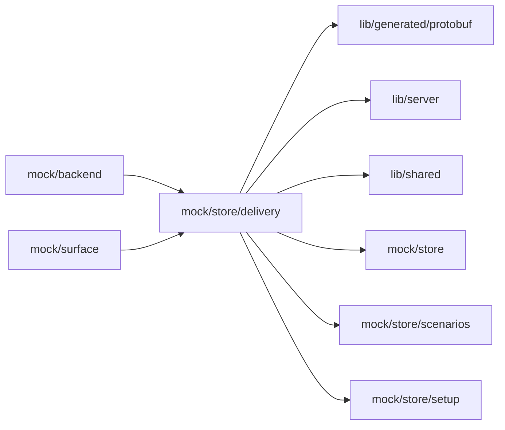

# Mock delivery feedback

<!-- BEGIN GENERATED DIRECTORY SUMMARY (scripts/check-readmes.mjs; edit only Purpose) -->
Purpose: The mock Agent's Live delivery feedback in Studio mock mode: script phrases that stand in for a failed Live deployment or an unfinished Live build.

Importers: `mock/backend` and `mock/surface` import this directory.

Imports: it imports `lib/generated/protobuf`, `lib/server`, `lib/shared`, `mock/store`, `mock/store/scenarios` and `mock/store/setup`.

<!-- END GENERATED DIRECTORY SUMMARY -->

`delivery-scripts.ts` answers the delivery [script phrases](../../README.md#script-phrases)
(`fail live deployment`, `fail live build`) before the ordinary scripts of `mock/store`. A Live
deployment that fails in a phase the application owns is a `failure` notice that opens an
automatic turn, which reads the delivery status, pushes a fix and asks the user to publish it; an
unfinished build is a platform `notice` that only notifies. No Release, build or deployment runs;
the server's hooks are in `internal/dexai/delivery/releases` and `internal/dexai/delivery/deployments`.
