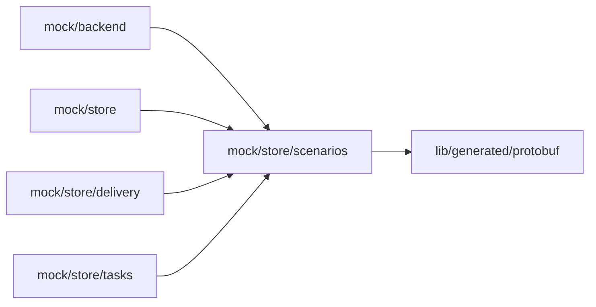

# Mock scenarios

<!-- BEGIN GENERATED DIRECTORY SUMMARY (scripts/check-readmes.mjs; edit only Purpose) -->
Purpose: The mock model's scenario catalog of Studio mock mode, whose inputs drive the mock Agent's scripts through the mock composer, and the markers its phrases ignore.

Importers: `mock/backend`, `mock/store`, `mock/store/delivery` and `mock/store/tasks` import this directory.

Imports: it imports `lib/generated/protobuf`.

<!-- END GENERATED DIRECTORY SUMMARY -->

The server's catalog is `internal/dexai/agents/session/modelprovider/mockmodel`; this fixture only
lets mock mode show the mock composer and run its inputs against the mock Agent's
[script phrases](../../README.md#script-phrases).
