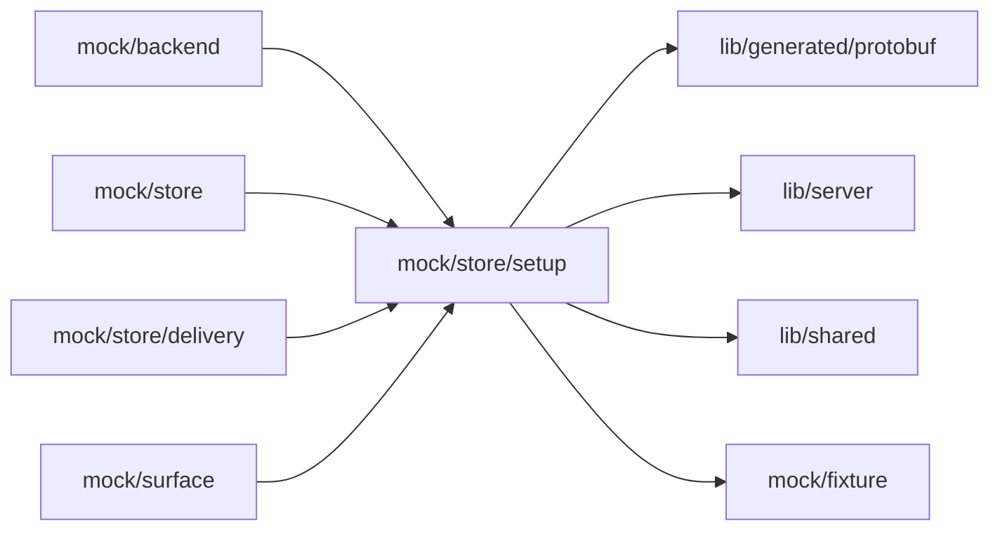

# Mock Setup

<!-- BEGIN GENERATED DIRECTORY SUMMARY (scripts/check-readmes.mjs; edit only Purpose) -->
Purpose: The mock's Setup state: the Preview's applied configuration and starts, Live's next-publish layer resolved against current Live, and the Slack and Stripe fixture connections.

Importers: `mock/backend`, `mock/store`, `mock/store/delivery` and `mock/surface` import this directory.

Imports: it imports `lib/generated/protobuf`, `lib/server`, `lib/shared` and `mock/fixture`.

<!-- END GENERATED DIRECTORY SUMMARY -->

`preview-setup.ts` keeps what PreviewFlow keeps across stops: the configuration the last applying
start froze, the newest 50 starts and the Preview's failure with its server-declared remedy. It
counts the head's changes against the applied configuration by item, a secret by presence only.
`next-publish.ts` resolves Live's next-publish layer: which items Live owns, each item's value from the
layer, Preview's applied values or current Live, its state (follows Preview, Live's own, no longer
used) and why it never follows (a secret, a connection tied to one address), and answers the item routes
Setup writes, `followPreview` included. `native-views.ts` answers the fixture's connection list and
environment form. `slack-fixture.ts` is the `slack` fixture's connection name with a start and a reply
trigger binding, its UI session, gaps and items; `stripe-fixture.ts` is the `endpoint-bound` fixture's
connection name, tied to one address.
