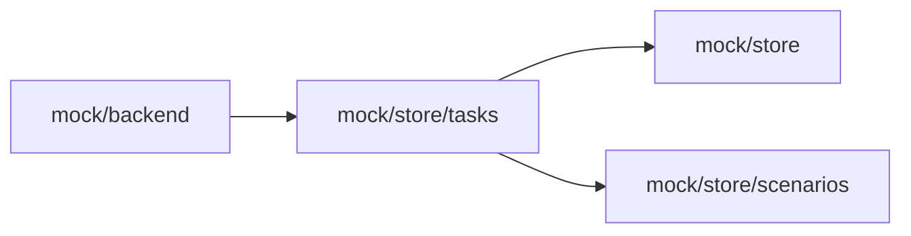

# Mock tasks

<!-- BEGIN GENERATED DIRECTORY SUMMARY (scripts/check-readmes.mjs; edit only Purpose) -->
Purpose: The mock Agent's background commands and subagents in Studio mock mode: their task scripts, the live line of a running subagent and the Stop button that stops them.

Importers: `mock/backend` imports this directory.

Imports: it imports `mock/store` and `mock/store/scenarios`.

<!-- END GENERATED DIRECTORY SUMMARY -->

`agent-tasks.ts` answers the task [script phrases](../../README.md#script-phrases)
(`run in background`, `finish task`, `start subagent`, `finish subagent`) before the other
scripts of `mock/store`, keeps the task records of the Session's Agent description, writes a
running subagent's live line as an activity event with its task ID, and is the Stop button
(`interruptAgent`). No command or subagent runs; the server's subagents are
`internal/agents/session/subagent`.
