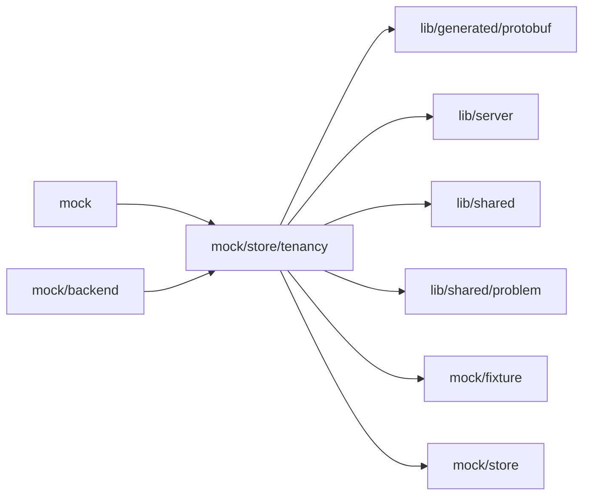

# Mock tenancy

<!-- BEGIN GENERATED DIRECTORY SUMMARY (scripts/check-readmes.mjs; edit only Purpose) -->
Purpose: The TeamSpaces, their members and the Projects' members of Studio mock mode, with the rules TeamSpaceFlow and ProjectFlow keep and the caller's role in each.

Importers: `mock` and `mock/backend` import this directory.

Imports: it imports `lib/generated/protobuf`, `lib/server`, `lib/shared`, `lib/shared/problem`, `mock/fixture` and `mock/store`.

<!-- END GENERATED DIRECTORY SUMMARY -->

State lives beside the store, keyed by it, so `store.ts` imports nothing of this directory. Every signed-in
account joins the seed TeamSpaces on its first call: an admin of Customer Ops, which holds the seed Projects, and
a member of Finance. In the seed Projects it is the owner of the ready one and an operator of the failed one, and
has no role in Supplier onboarding. The fixture people Priya, Sam and Jo never sign in.

Customer Ops holds one READY API key connection of the fixture connector
(`connections.ts`). An admin, or the owner or builder of one of the TeamSpace's
Projects, manages connections; entered values are discarded and only the names
of stored credential fields are kept. An authorization's provider page is the
mock's own callback, which completes it at once with fixture tokens. The
Configuration fixture's selections name a connection by its ID and do not reach
this store, so no connection records a usage.
