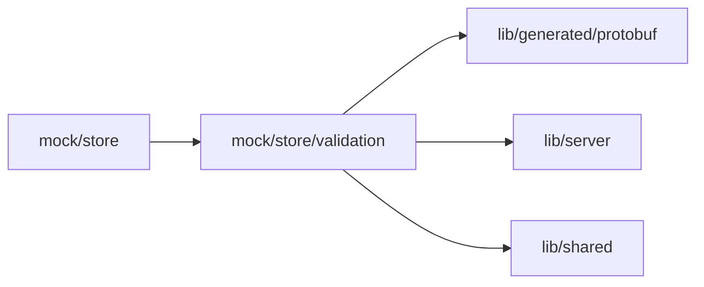

# mock/store/validation

<!-- BEGIN GENERATED DIRECTORY SUMMARY (scripts/check-readmes.mjs; edit only Purpose) -->
Purpose: Checks Preview evidence when the mock store admits a release build.

Importers: `mock/store` imports this directory.

Imports: it imports `lib/generated/protobuf`, `lib/server` and `lib/shared`.

<!-- END GENERATED DIRECTORY SUMMARY -->
