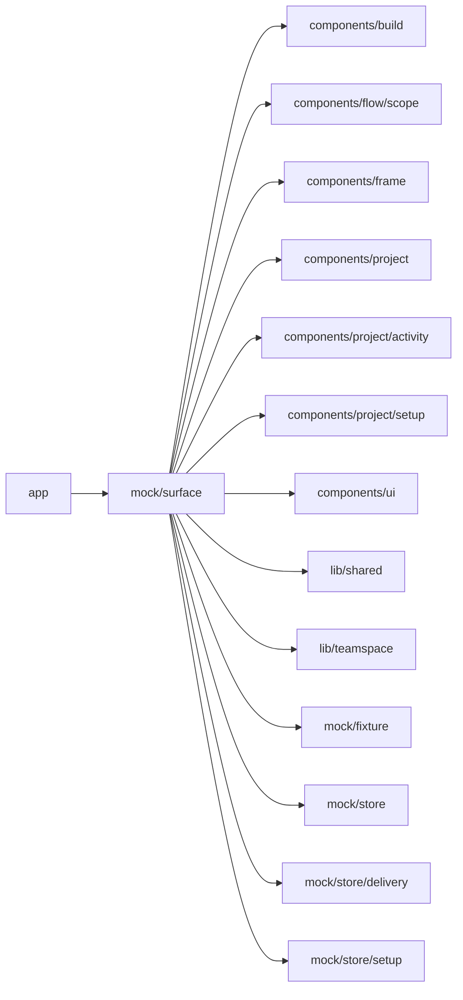

# Mock surfaces

<!-- BEGIN GENERATED DIRECTORY SUMMARY (scripts/check-readmes.mjs; edit only Purpose) -->
Purpose: The fixture Project surface inside the Builder frame with its role lens and the named Setup fixtures, which mock routes render in place of the production surface.

Importers: `app` imports this directory.

Imports: it imports `components/build`, `components/flow/scope`, `components/frame`, `components/project`, `components/project/activity`, `components/project/setup`, `components/ui`, `lib/shared`, `lib/teamspace`, `mock/fixture`, `mock/store`, `mock/store/delivery` and `mock/store/setup`.

<!-- END GENERATED DIRECTORY SUMMARY -->
