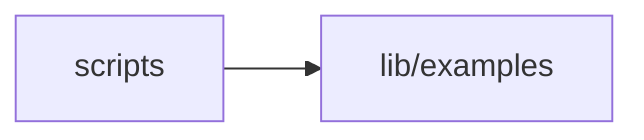

# Studio scripts

<!-- BEGIN GENERATED DIRECTORY SUMMARY (scripts/check-readmes.mjs; edit only Purpose) -->
Purpose: Generators and checks of the Studio source: protobuf types, consumed pins, the module graph, the module and styling rules, the example search's data and these directory READMEs.

Importers: no production directory imports this directory.

Imports: it imports `lib/examples`.

<!-- END GENERATED DIRECTORY SUMMARY -->

| Script | Does |
| --- | --- |
| `generate-protobuf-types.mjs` | Generates `lib/generated/protobuf` from the business proto; `--check` verifies it. |
| `check-consumed-pins.mjs` | Checks the initial Design, the UI boundary and packages pinned outside the registry. |
| `module-graph.mjs` | Resolves every import of the hand-written source; the checks below read it. |
| `check-modules.mjs` | Directory and file limits, names, no JavaScript, an acyclic directory graph and client reachability. |
| `check-readmes.mjs` | Every directory README's generated summary, the module table and relative links; `--write` regenerates them. |
| `check-example-search.mjs` | A data check of the generated example search: on every labelled request the TypeScript search ranks as the Go search does, each expected example is in the grid's top six, and every placeholder is a labelled request that starts from the default. |
| `check-styles.mjs` | After `next build`: CSS only in `app/`, selector allowlists, no `@apply`, every class token in the built CSS, every custom property defined, no glued class strings. |

`tsconfig.json` type-checks these scripts (`tsc -p scripts`).
