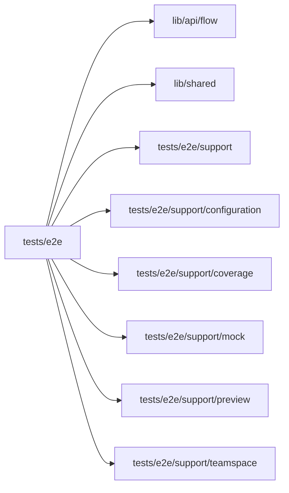

# Real Studio acceptance

<!-- BEGIN GENERATED DIRECTORY SUMMARY (scripts/check-readmes.mjs; edit only Purpose) -->
Purpose: The three required acceptance specs of the local lanes: registration, a Project edited and released through Studio, and an Agent-added Flow approval.

Importers: no production directory imports this directory.

Imports: it imports `lib/api/flow`, `lib/shared`, `tests/e2e/support`, `tests/e2e/support/configuration`, `tests/e2e/support/coverage`, `tests/e2e/support/mock`, `tests/e2e/support/preview` and `tests/e2e/support/teamspace`.


<!-- END GENERATED DIRECTORY SUMMARY -->

`SUPERVERSE_E2E_BASE_URL` must identify a running Local Native, Local Kind or hosted V2 Studio.
The runner rejects Studio mock mode. Node/npm, Chrome (or
`PLAYWRIGHT_CHROMIUM_EXECUTABLE_PATH`) and read access to the Git host of the
deployment are required: the local Git host's JSON interface in the local lanes, which
the runner provides, or genuine GitHub CLI read access to the owned V2 project
repositories for a GitHub deployment. Missing credentials or unavailable
services fail the run; they are not skipped or replaced with fixtures.

Install and build `web/studio`. The only retained browser project is Chromium,
with TLS verification enabled.

## Layout

- The root holds the three required cases of the local lanes, `registration.spec.ts`,
  `create-project.spec.ts` and `template-approval.spec.ts`. The acceptance
  runner (`infra-as-code/scripts/acceptance/browser.py`) and release evidence
  name them by these bare file names, so they stay here.
- `integration/` holds focused scenarios against existing private fixtures.
- `journey/` holds retained journeys that keep their resources.
- `support/` holds the modules the specs share; specs import them as
  `@/tests/e2e/support/<module>`.

The acceptance runners are `./infra-as-code/sv2 native e2e` and
`./infra-as-code/sv2 kind e2e`, which run exactly the three root specs on the lanes
`make required-lanes` names; only a Kind receipt of the unchanged `local-kind-acceptance.yaml` gates an AWS
wave, with the model the platform developer decided on ([Mock model](#mock-model)). Playwright's `testDir` (`tests/e2e`) includes every
sub-directory, so `npm --prefix web/studio run test:e2e` (and `npm test`) runs
every spec: also the `integration/` scenarios, which fail without their private
fixtures, and the `journey/` specs, which keep their resources. Its result is
not acceptance. To run one spec, pass its path to Playwright as the sections
below show.

The create-project case publishes Live twice for the same Project, requires a
new READY deployment and increasing generation at the same public URL, checks
that the previous deployment loses its Flow API grant, then removes the current
Live deployment and deletes the Project. Both publishes exercise the application
and Studio Runs against actual dependencies.

## Selectors

Specs find Studio elements by role, label, text or test ID (`data-testid`),
never by CSS class: class names are styling and change with it. Where no role
or label identifies an element, the component carries a test ID, which users
never see. The one exception is the application under test, whose markup
Studio does not own: its page is held in a variable named `app`, as in
`support/publishing.ts` and `journey/greeting-flow.spec.ts`.

## File map

Every case below needs `SUPERVERSE_E2E_BASE_URL`. A "private fixture" is an
absolute path to a regular JSON file (no symlink) readable only by its owner
(mode 0600 or 0400), at most 16 KiB, read through `support/private-files.ts`.
An owner fixture holds an existing account's `email` and `password` (an empty
password is a valid account password) plus the fields listed for its case.

| File                                         | What it proves                                                                                                                                                                                                                                                                                                                                                                                                                                                                                                                                                                                                                                                                                                                                                                                                                                                                                                                                                                                                                                                                                                                                                                                                                                                                                                               | Requires                                                                                                                                                                                                                         |
| -------------------------------------------- | ---------------------------------------------------------------------------------------------------------------------------------------------------------------------------------------------------------------------------------------------------------------------------------------------------------------------------------------------------------------------------------------------------------------------------------------------------------------------------------------------------------------------------------------------------------------------------------------------------------------------------------------------------------------------------------------------------------------------------------------------------------------------------------------------------------------------------------------------------------------------------------------------------------------------------------------------------------------------------------------------------------------------------------------------------------------------------------------------------------------------------------------------------------------------------------------------------------------------------------------------------------------------------------------------------------------------------- | -------------------------------------------------------------------------------------------------------------------------------------------------------------------------------------------------------------------------------- |
| `create-project.spec.ts`                     | Required case of the local lanes: a new Teamspace, managed creation in it, concurrent duplicate admission, a retry after READY, same-request input conflict, rejection of absent/retired sources and the removed repository-list RPC; a template Project's real Agent turns, "Keep running for 7 days" from the chat header's More details on the READY workspace (a Sandbox deadline seven days ahead), Watch reconnect during streamed text, pushed head, the configuration notice of the push's automatic Preview deployment, Preview, immutable Release, Live published once through the Publish popover on the version Preview ran (a build with an automatic deployment, followed in Tools, Publishing's stage bar) and once again as Live's own version from the Live tab, account isolation (an account outside the Teamspace neither lists nor reads it or the Project), Live removal and Project deletion. With the local mock model, the heading edit also declares an optional environment value; the Project saves it through Studio Setup, covering `SaveApplicationEnvironment` on the same publish journey. The Agent's heading edit is verified at the actual Preview and Live URLs. It also probes the strict `/api/rpc` boundary: a CreateProject or ListProjects without a Teamspace, an unknown field, a body `caller`, a malformed uint64 fence and an undeclared or zero status filter are 400, `Login`, `GetFlowCatalog` and `getProject` are 404, and a GET of a unary RPC or a POST of a Watch is 405.    | `SUPERVERSE_E2E_OPENAI_FILE`                                                                                                                                                                                                     |
| `template-approval.spec.ts`                  | Required case of the local lanes: one fixed prompt makes the real Agent add a human approval Step and Action to the template's `TextSummaryFlow` and push it; the push's automatic deployment stops at the unconfigured Preview with its configuration notice, and the owner configures Preview and starts it; a second account then joins the Teamspace through People and the Project as an operator through Permissions and sees Live only, without Preview, chat or Tools; Preview, by the owner, and Live, by the operator, each start the Flow in Studio (Test run, then Live run), read its Diagnostics while it waits, approve it through the run drawer, which opens on the waiting Step ringed "now", after the canvas opens framed on that Step with the Steps a transition joins to it wholly in view and keeps its lines through two run polls, and complete it; the bar's Preview                                                                                                                                                                                                                                                                                                                                                                                                                                                                                           | Live switch then moves the Flow, Runs, Interface and chat to Live and back; then Live removal and Project deletion. See [Template approval](#template-approval).                                                                 | `SUPERVERSE_E2E_OPENAI_FILE` |
| `registration.spec.ts`                       | Registration, duplicate rejection, cookie properties, the new account's first Teamspace with its retried creation, logout revocation, wrong-password rejection, and sign-in that reopens the Teamspace.                                                                                                                                                                                                                                                                                                                                                                                                                                                                                                                                                                                                                                                                                                                                                                                                                                                                                                                                                                                                                                                                                                                      | Nothing else                                                                                                                                                                                                                     |
| `integration/administrator-projects.spec.ts` | The administrator lists, observes and manages the Teamspaces and Projects of different owners, and deletes the Teamspaces.                                                                                                                                                                                                                                                                                                                                                                                                                                                                                                                                                                                                                                                                                                                                                                                                                                                                                                                                                                                                                                                                                                                                                                                                   | `SUPERVERSE_E2E_ADMINISTRATOR_FILE`                                                                                                                                                                                              |
| `integration/flow-api-authorization.spec.ts` | The Flow API binds exact targets and rejects revoked sessions immediately; see [Flow API authorization](#flow-api-authorization). Its fixture and probe helpers are in `integration/flow-api-probe.ts`.                                                                                                                                                                                                                                                                                                                                                                                                                                                                                                                                                                                                                                                                                                                                                                                                                                                                                                                                                                                                                                                                                                                      | `SUPERVERSE_E2E_FLOW_API_FIXTURE`, `SUPERVERSE_GRPC_ADDRESS`                                                                                                                                                                     |
| `integration/session-watch-queue.spec.ts`    | A Session Watch discards queued data after login revocation or request abort; malformed Agent commands report `AGENT_COMMAND_NOT_DISPATCHED` or `AGENT_COMMAND_NOT_ADMITTED`. Runs the BFF handler in process against merged gRPC.                                                                                                                                                                                                                                                                                                                                                                                                                                                                                                                                                                                                                                                                                                                                                                                                                                                                                                                                                                                                                                                                                           | `SUPERVERSE_E2E_WATCH_FIXTURE` (owner fixture with the `projectId` of a READY Project, whose one Session the Watch reads), `SUPERVERSE_GRPC_ADDRESS`                                                                             |
| `integration/workspace-account.spec.ts`      | The workspace reads the account once per document and keeps it across navigation, counted from Studio's grpc-js channel trace.                                                                                                                                                                                                                                                                                                                                                                                                                                                                                                                                                                                                                                                                                                                                                                                                                                                                                                                                                                                                                                                                                                                                                                                               | `SUPERVERSE_E2E_ACCOUNT_NAV_FIXTURE` (owner fixture with the `projectId` of a READY Project), `SUPERVERSE_E2E_STUDIO_GRPC_TRACE_FILE` (Studio's private trace log), `SUPERVERSE_E2E_ISOLATED_STUDIO=true` (no competing clients) |
| `integration/problem-format.spec.ts`         | A template Project's first push, refused by the Preview for the connection it lacks, shows the one problem format: what happened, why with the missing configuration, the declared Open Setup fix and the folded technical details, which alone name the code, the phase and the commit. Runs on the mock model.                                                                                                                                                                                                                                                                                                                                                                                                                                                                                                                                                                                                                                                                                                                                                                                                                                                                                                                                                                                                             | None beyond `SUPERVERSE_E2E_BASE_URL`                                                                                                                                                                                            |
| `integration/publishing-observation.spec.ts` | Publishing reattaches to the exact Release and active Deployment Watches after a reload, with Release listing bounded at 50 per request. Read-only.                                                                                                                                                                                                                                                                                                                                                                                                                                                                                                                                                                                                                                                                                                                                                                                                                                                                                                                                                                                                                                                                                                                                                                          | `SUPERVERSE_E2E_PUBLISHING_FIXTURE` (owner fixture with `projectId`, `sourceCommit`, `releaseId` and the `deploymentId` of the active deployment)                                                                                |
| `integration/publishing-preparation.spec.ts` | Reopening the Publish popover on a version whose Release preparation failed shows the failure and admits no new preparation. Read-only.                                                                                                                                                                                                                                                                                                                                                                                                                                                                                                                                                                                                                                                                                                                                                                                                                                                                                                                                                                                                                                                                                                                                                                                      | `SUPERVERSE_E2E_STORAGE_STATE` (private authenticated browser storage), `SUPERVERSE_E2E_PREPARATION_PROJECT`, `SUPERVERSE_E2E_PREPARATION_COMMIT` (an owned Release whose prepared source FAILED)                                |
| `journey/*.spec.ts`                          | Retained journeys that keep their resources; see [Retained journeys](#retained-journeys-no-cleanup) and [One-prompt release newsletter authoring](#one-prompt-release-newsletter-authoring).                                                                                                                                                                                                                                                                                                                                                                                                                                                                                                                                                                                                                                                                                                                                                                                                                                                                                                                                                                                                                                                                                                                                 | `SUPERVERSE_E2E_PRIVATE_STATE_DIR` and the variables listed there                                                                                                                                                                |

Shared modules:

- `support/account.ts`: a fresh account `identity`, registration and sign-in.
- `support/project.ts`: Project and Session reads and creation (the first turn is typed
  with `typePrompt` or chosen with `chooseMockFirstInput`), completed-turn
  waits (a Session without a selected model, or one that waits for an answer or an
  approval, fails them; a requirements card never waits, because the agent records it and
  goes on building in the same turn), the wait for the agent's first recorded
  requirements card, version 1 or later (`waitForRequirementsCard`), the asserted sequence
  of a completed turn's newest final reply (`expectNewestFinalReplySequence`),
  `expectPushedHead`, the `AgentModel` enum value of a server model
  (`agentModelEnum`), "Keep running for 7 days" with its renewed Sandbox
  deadline (`keepWorkspaceRunning`) and Project deletion.
- `support/mock/mock-composer.ts`: whether the spec chooses the mock model, which
  `SUPERVERSE_E2E_MODEL_TARGET` or the lane's offer decides (`choosesMockModel`),
  and whether a Project's Session runs it, the first input chosen on the creation page and
  its turn awaited (`chooseMockFirstInput`, `waitForFirstMockInput`), and a scenario's inputs,
  all or the numbered ones, sent through the mock composer in order, each checked against the
  progress the newest mock reply reports (`runMockScenario`, `sendMockInput`).
- `support/configuration.ts`: Preview and Live configuration validation, which
  prepares the Session's HEAD first when the Preview configuration asks for it
  (the "Prepare current source" button), and the template's `summary-model` OpenAI
  connection (`fillTemplateSummaryConnection`).
- `support/configuration/recovery.ts`: opt-in real BFF/gRPC read-failure coverage
  inside `create-project.spec.ts`, with the exact owned Native `run.json` in
  `SUPERVERSE_E2E_NATIVE_READ_FAULT_RUN_FILE` and its run ID in
  `SUPERVERSE_E2E_NATIVE_READ_FAULT_RUN_ID`. It pauses only that run's proven
  server process, then checks automatic recovery with the prior configuration
  retained, the total read deadline, manual retry and cancellation on leaving
  Configuration. It resumes the service even on failure and records safe
  status/timing evidence in the existing case's attachment. No fourth case or
  mock dependency is introduced.
- `support/publishing.ts`: Preview start, the wait for a push's automatic
  Preview deployment to serve it (`awaitDeployedPreview`), Release build, Live
  deploy and removal, and the template heading-edit prompt `headingChangePrompt`
  and its exercises `previewTemplateEdit`, which first waits for the
  configuration notice of the push's deployment to the unconfigured Preview,
  and `publishTemplateEditLive`.
- `support/flow-run.ts`: the template text-summary exercises in the
  application and in Studio Runs, including the approval variant
  `exerciseApprovalInStudio`.
- `support/session-transport.ts`: observes Chrome's actual Session Watch
  traffic for the single-Watch, reconnect and streamed-text reconciliation
  assertions, and `withDeadline`, which bounds a wait the specs cannot cancel.
- `support/repository-host.ts`: reads of the deployment's Git host, chosen by
  `SUPERVERSE_E2E_REPOSITORY_HOST` (`github` through the `gh` CLI, or `localgit`
  through the host's JSON interface with the administrator token in the private file
  `SUPERVERSE_E2E_LOCAL_GIT_TOKEN_FILE`, at `SUPERVERSE_E2E_LOCAL_GIT_URL`): the
  commit of a branch (`branchHead`) and a file at a commit (`repositoryFile`), and the
  GitHub-only `githubJSON`. The runner sets the variables from the deployed profile,
  and an unset host is GitHub.
- `support/private-files.ts`: private fixture reads and the owner fixtures
  (`ownerFixture`, `ownerProjectFixture`).
- `support/studio-api.ts`: `rpc(context, method, input)`, a same-origin POST
  to `/api/rpc/<Method>` typed by the generated contract that returns the raw
  response, `rpcResult` for an RPC that must succeed (it asks a 503, the server's
  temporary unavailability, again after its Retry-After for up to a minute, and
  any other failure carries only the HTTP status), `rpcPosted` and `rpcAnswered` to match the page's own RPC
  requests and responses, `UUID` for the request IDs the page generates,
  `studioOrigin()` for raw boundary probes, the private owner-state directory
  and credential-safe form filling.
- `support/json-assert.ts`: assertions for JSON read from fixtures and services.

## Application template text summary

New projects start from the in-repository `app-template`, whose reference
`TextSummaryFlow` calls the released llm connector. `create-project.spec.ts`
(a required Local Kind case) and `journey/new-project.spec.ts` therefore save the
template's `summary-model` OpenAI connection through the native configuration UI
before validating Preview and Live, and then run a real summary twice per target:
through the application's own form and API, and through Studio Start Flow with the
typed Display and a retained read after refresh. Both require status `completed`,
a nonempty summary, a reported model and positive token usage. Set
`SUPERVERSE_E2E_OPENAI_FILE` to a private JSON file containing `apiKey`; without
it these cases fail instead of skipping.

Their Session's push deploys itself to a Preview that nobody configured yet, so
each case first waits for that deployment to end (`previewTemplateEdit`): the
Preview is `STOPPED` with `PREVIEW_CONFIGURATION_INCOMPATIBLE` in the phase
`deploy-preview`, its release having freed the Project's Preview route, and the
conversation shows the `delivery` notice whose summary names the pushed commit and
`summary-model`. Only then does the person save the connection, validate Preview
and start it with Start Preview.

## Template approval

`template-approval.spec.ts` registers an account, creates its Teamspace and a template Project
whose first and only prompt, `APPROVAL_PROMPT` in the spec, asks the real Agent to
change `internal/process/text_summary_flow.go`: a Step `AwaitSummaryApproval`
between `GenerateSummary` and `SaveSummaryResult` waits on a new Channel
`SummaryApprovals` while `summary-status` is `awaiting-approval`, and an Action RPC
`ApproveSummary` (label "Approve summary", permission `summary.approve`) publishes to
it. The prompt points at the template's `AGENTS.md` and the in-repository skill
section "Answer a waiting Step", and asks for the requirements card before any change.
The card does not wait: the agent records it as version 1 and builds it in the same turn.
On the mock model the `summary-approval` scenario's first input, chosen on the creation page,
shows it (R1 the approval Step, R2 the Action), streamed at 100 ms per delta: from the moment the
Project is created the case watches the Flow tab, to which the first conversation switches at the
card's first draft, show "Drafting" on the canvas's corner with the designed Steps' names as dashed
boxes, until the card is recorded; then, while the design is built, the drawn design with "Building ·
N of 6 steps written", the card's summary under the canvas, no Confirm and build or Change something…,
and behind More details the outline and the design changes. As soon as the Project is created, the person
configures the Session's Preview, saving the `summary-model` connection, while the turn runs up
to its source gate. The case then waits for the card (`waitForRequirementsCard`) and, on the mock
model, checks the chat's one line "Recorded version 1: Summary approval", which opens to the card, the
marked diagram, and that, once the scripted edit declared `AwaitSummaryApproval`, the design reads
"6 of 6 steps written" with that Step solid, unless the push built it first. Once the push built the
design, the overview is gone and the Flow tab shows only the flow. The turn's
`commit_and_push` traces R1 and R2 at version 1 (each with an `untested_reason`, because the llm
connector has no mocks yet) and passes the commit gate's test stage, which runs the template's
API tests. The case waits for
the completed turn and requires the Session head on the default branch of the repository
host. The push deploys itself to the configured Preview: without Start Preview, the case
waits until the Preview is READY at the pushed head, which the build page shows as the
deployed commit with its Open Preview link.

Before Live runs, a second account registers in a browser context of its own; the owner adds it to the Teamspace
in People and to the Project as an operator in Tools, Permissions, and the case waits until the read model lets
it open the Project, which it sees on Live only, without Preview, the chat or Tools.

The Preview, by the owner, and then Live, by the operator (after the owner's Release build, configuration and
deployment, which saves the `summary-model` connection again for Live), each start `TextSummaryFlow` through Studio Start Flow and
require the serving definition to declare exactly that Action. Once the typed
Display reports `awaiting-approval` with `ApproveSummary` eligible, the case opens
Diagnostics of the waiting run from its drawer and requires the Flow API summary,
history and state reads to succeed, a WaitFlowHistory long poll, and a Timeline
whose event count and "Flow started" event render. The first idle history wait
must receive a complete server 408 with Dex DeadlineExceeded after 30 seconds
and before the client's 35-second backstop, then wait again at the same cursor
without an error banner. The case also opens Streams and reads an empty Stream
key through the real serving Dex API, requiring the same 408 and resume-token
continuation without a banner. Both Preview and Live run these checks and record
their observed status and duration in the browser report annotations. The runner
uses fresh HTTP connections; Chromium's retry of 408 on reused HTTP/1.1 connections
can still reach the browser backstop. It then presses
**Approve summary** in the run drawer, the same control a person uses, and requires
completion with a nonempty summary, a reported model, positive token usage, no
remaining eligible Action and an unchanged Display after reload. Finally it stops
Live and deletes the Project. It needs only `SUPERVERSE_E2E_OPENAI_FILE` and the server's
model and GitHub App credentials; no operator step is involved.

## One-prompt release newsletter authoring

`journey/release-newsletter.spec.ts` sends the exact prompt of test-environment
Session `yamc/79nvnqsa` to a new project and no follow-up message. It records the
initial `app-template@<tree>` revision and TextSummaryFlow Design, then requires a
`commit_and_push` whose outcome is `OUTCOME_SUCCEEDED` (the public history never
carries a tool result's content) and whose head matches the pushed remote head, a
unchanged business prompt in the complete durable history as its only user message,
which CreateProject carried, so Studio sends no SendMessage, no `request_user_input`,
valid strict FDG 2.0 definitions without the template
reference Flow, and released GitHub `listReleases`, OpenAI/llm `generateText` and
Gmail `sendMessage` connections. Model calls, tool calls, failed tool calls, the requirements cards and the
recorded version, reads of installed references (tool call targets starting with `skills:` or
`module:`) and authoring time are written to the private
`release-newsletter-journey.json` and the test attachment for comparison across
models; message bodies and tool arguments are not exported. Set
`SUPERVERSE_E2E_MODEL_TARGET` to a server model such as
`anthropic/claude-sonnet-5-5` to run and assert that coding model, which has no default (`mock` skips this journey; it is
mapped to its `AgentModel` enum value before the comparison), and
`SUPERVERSE_E2E_LOGIN_FILE` to a private owner fixture to reuse an account
(otherwise a new account is registered). Real GitHub, OpenAI and Gmail execution, Inbox review and delivery
need private provider configuration and are a separate configured acceptance;
this journey does not replace the three required Local Kind cases.

## Manual real-provider newsletter

`manual/newsletter-product.spec.ts` is an opt-in product scenario. It creates a fresh
Teamspace and Project, runs the `newsletter-app` mock-model script through its first
successful push, configures four real Teamspace connections in Setup, chooses the Slack
channel and admin member through Studio's pickers, starts Preview, subscribes one
recipient, posts `publish newsletter` as that admin using an optional Slack user token
or pauses for the operator to post it, finds the new campaign through Preview Runs,
and requires one successful Gmail
delivery in the completed campaign. The one-recipient campaign makes the aggregate
`recipientCount=1, sentCount=1, failedCount=0, unknownCount=0` a per-recipient assertion.
The test does not run in the three default E2E cases, `make required-lanes`, or `make ci`.

Run it only on a built Local Native instance, with a headed browser and the private
`SUPERVERSE_E2E_NEWSLETTER_FILE` described in the private manual newsletter runbook.
The operator completes each Slack, GitHub and Google consent screen in that browser.
The fixture, self-signed localhost certificate and configuration layer stay outside Git; set
`SUPERVERSE_E2E_CAPTURE=off` to keep credential-bearing browser artifacts off disk.
Only this manual spec accepts the local callback certificate. The test asks for
a Slack message link only if its Preview Runs lookup cannot find the campaign.


## Additional scenarios

`integration/administrator-projects.spec.ts` covers normal administrator login, two distinct
ordinary owners, each with a Teamspace of their own, and actual managed Project provisioning; the
administrator's listing of every Teamspace and of each one's Projects as their owner,
configuration/resource reads, snapshot-first reconnect, the rejection of an owner outside the other's
Teamspace, administrator deletion of the Projects and terminal cleanup snapshots, and the
administrator's deletion of both Teamspaces, one through its Home's dialog after typing its name, which
their owners may not do. It needs
`SUPERVERSE_E2E_ADMINISTRATOR_FILE`, an absolute path to a private regular 0600
JSON file containing the configured platform administrator address in `email` and the password of the
normally registered account. It never resets an existing password, reads tokens
from reports, substitutes auth or claims the three full business journeys passed.
Run this additional scenario explicitly after the platform is ready. Its two
managed repositories are created for this scenario and archived by normal
DeleteProject, and its two Teamspaces are deleted by DeleteTeamSpace. Session/tool/Preview/Release/Live mutations require the full
business journeys in addition to these narrower administrator checks.

## One Session per Project

A Project has exactly one Session, which its ProjectFlow starts when the Project
becomes READY; the Project ID addresses it and every turn of a spec runs in it.
The creation page shows the Session's own model picker and composer, so a spec chooses
the first turn there (`createProject` takes that choice: `typePrompt` chooses the real model
that `SUPERVERSE_E2E_MODEL_TARGET` names, and types the prompt;
`chooseMockFirstInput` chooses the mock model and a scenario's first input) and presses
Build. CreateProject carries the first message, its message ID and the model, so the Session
starts on that model with the message admitted once, without the page. `createProject` returns
once the Project is READY and its Session exists, after it checked that the Session holds exactly
one copy of the first message despite four concurrent repeats of the request, that it runs the
chosen model, and that a repeat with a changed name or message is refused; a spec then
waits for that turn (`waitForCompletedTurn`, or `waitForFirstMockInput` on the mock model)
before it sends the next change through the composer (`sendChange`) or, on the mock model,
through the mock composer. No Session list, `?session=` parameter or Session stop exists.

## Workspace on demand

A new Session has no Sandbox. Its workspace instance is started on first demand:
beside the first model call of the first Agent turn, or by an accepted Start Preview.
Until then Session snapshots carry `workspace: null` and a `PREVIEW_STATUS_NOT_STARTED`
Preview. The first reply and the requirements card do not wait for the instance, but a
workspace tool does, so scenarios wait for a completed Agent turn that used one before
they assert `workspace.status == "WORKSPACE_STATUS_READY"`. The
Preview configuration scope names no workspace: it reads the source prepared for
the Session's HEAD and never starts a Sandbox, and an unprepared HEAD reads
the "Prepare current source" button, which `configure` answers by preparing it. An accepted Start Preview must read back as
`PREVIEW_STATUS_STARTING` or `PREVIEW_STATUS_READY` with the accepted generation, a non-decreasing revision and
no failure. The Session reclaims an instance one hour after the main agent last
used it by default (its Sandbox deadline, `workspace.expiresAt`), and "Keep
running for 7 days" moves that deadline seven days ahead; the Session then
stays ACTIVE and its next demand starts a new instance with a new
WorkspaceRequestID on the same volume. Bind requests to that identity and the
observed generation; neither a prior instance nor its running Preview and its
route survive the reclamation, and the next start serves the Preview under the
same URL.

`create-project.spec.ts` observes Chrome's actual EventSource traffic. It
requires one page-owned Session Watch, snapshot-first reconnect, and the canonical
`agent`, `workspace` and `preview` properties on every snapshot. `workspace` is
null until the Session's first workspace demand has started a Sandbox instance;
`preview` is always present. It rejects old Agent product paths and
separate workspace or Preview readers. Agent completion checks fail immediately
on a terminal Session with a safe identity/status/code message, never raw tool output.

## Flow API authorization

`integration/flow-api-authorization.spec.ts` uses the actual Studio HTTP BFF, named generated gRPC,
Account/Project/Session Flows, serving Dex and prepared configuration storage.
It asserts that the first request after direct server-side logout returns 401,
including a supported POST with the original valid CSRF token; there is no TTL
or cache-grace expectation. It also checks fresh login token binding, real HTTP
logout replay, ordinary non-owner/anonymous/forged-envelope rejection, exact
Preview Runs workspace request/generation and Live deployment fences, a Preview
configuration that names no Sandbox instance (any instance or deployment header
is 400), commit-specific configuration, stale definitions, CSRF
origin/scope/commit binding, and rejection of browser-supplied authority or
Worker/bypass/permission fields.
All three Preview commands also reject each missing observation field (Go
returns 400; the BFF forwards the request as sent; a command without a
workspace request ID instead observed a Preview that never acquired an
instance, which this Preview rejects as stale with 409) and a stale workspace
identity (409) through both `/api/rpc` and direct gRPC. The scenario verifies
that these rejections preserve the exact Preview revision and prepared source;
it never sends a valid Preview command.

Prepare an absolute path to a private regular mode-0600 JSON file (no symlink,
maximum 16 KiB), then set `SUPERVERSE_E2E_FLOW_API_FIXTURE`:

```json
{
  "schemaVersion": 2,
  "projectId": "<existing-project-id>",
  "releaseId": "<currently-serving-release-id>",
  "sourceCommit": "<already-prepared-40-character-commit>",
  "owner": { "email": "<existing-project-owner>", "password": "<private-password>" },
  "nonOwner": { "email": "<different-existing-ordinary-account>", "password": "<private-password>" }
}
```

Both accounts must be ACTIVE. The owner must hold the owner role in the existing READY
Project; the other account must have no role in it (for example, be outside its Teamspace) and not
be the administrator.
The Project's Session, workspace, prepared Preview source and Preview must already
be ACTIVE/READY, with at least five minutes remaining before the workspace's
Sandbox deadline. Live must already be READY at the supplied Release, and both serving FDGs
must contain a usable Flow type. The supplied commit must already have a prepared
Live configuration draft. The test reads deployment/workspace identities from
fresh authorized snapshots and freezes those observed selectors for the run.
Do not recreate, renew, rebuild or redeploy these resources concurrently.

Use the matching merged gRPC address and TLS settings for the same server that
Studio uses; this direct connection revokes only the scenario's secondary login.
With those prerequisites exported, run only this additional scenario:

```sh
npm exec --prefix web/studio -- playwright test tests/e2e/integration/flow-api-authorization.spec.ts \
  --config web/studio/playwright.e2e.config.ts --project=chromium --workers=1 --reporter=line
```

The runner requires `SUPERVERSE_E2E_BASE_URL` and `SUPERVERSE_GRPC_ADDRESS`, rejects
mock mode, and fails on missing dependencies. It disables traces, screenshots and
video, disposes request contexts and revokes its secondary logins. It performs
real read-only Searches and sends native-form probes for an undeclared connection,
which must fail before provider/session/configuration writes. It does not create
accounts or Projects, start Flows, edit credentials, or change serving resources.
Only safe resource identities and observed pass/fail coverage are attached.
Actual browser Start/Actions/OAuth and infrastructure recreation require their
separate real scenarios; this focused check does not satisfy the three full
business journeys or claim an unexecuted Native/Kind result.

## Retained journeys (no cleanup)

Retained journeys leave their Project, Session and Live deployment in place for
later inspection. They are not part of the three-case acceptance runner; run them
directly with Playwright against a ready Local Kind (`http://localhost:23000`) or
Local Native (`http://localhost:21000`) Studio:

```sh
SUPERVERSE_E2E_BASE_URL=http://localhost:23000 \
SUPERVERSE_E2E_PRIVATE_STATE_DIR=/absolute/private/owner-state \
npm exec --prefix web/studio -- playwright test web/studio/tests/e2e/journey/new-project.spec.ts \
  --config web/studio/playwright.e2e.config.ts --project=chromium --workers=1 --reporter=line
```

- `journey/new-project.spec.ts`: registers an account, signs out and in again,
  creates a template Project whose first real Agent turn edits, checks, commits and
  pushes; verifies the Session HEAD against the repository host and that the on-demand workspace
  is READY; waits for the configuration notice of the push's automatic Preview deployment,
  validates Preview configuration, starts Preview and exercises the app;
  validates Live configuration, builds a Release, deploys Live and exercises it.
- `journey/greeting-flow.spec.ts`: signs in through the actual Studio UI using
  `SUPERVERSE_E2E_LOGIN_FILE`, a private owner fixture for the existing test
  account; creates a fresh template Project; asks the
  real Agent to implement and push a `GreetingFlow`; verifies its source and
  immutable Release Flow Definition; deploys Live; starts, approves and reads
  the greeting, including after a page reload. It retains the Project without
  creating a Preview. The owner-state directory contains a mode-0600 browser
  storage file, resource checkpoint and result screenshots for later inspection.
  If an operator resolves a real Agent question or approval after a failed run,
  `SUPERVERSE_E2E_RESUME_FILE` may identify that private resource checkpoint.
  The resumed journey signs in again and verifies the same Project and its Session;
  it does not create replacement resources or treat the failed attempt as passed.
  A resumed workspace may be CLOSED after its Sandbox deadline; the test still requires the
  Session HEAD to match the actual branch of the repository host and builds that immutable source.

Each journey writes the owner account and resource identities to a new mode-0600
file in the private owner-state directory. These journeys do not satisfy the
three-case acceptance gate.

## Mock model

New Sessions on Local Kind and Native start on the mock model
([runbook](../../../../internal/dexai/agents/README.md)), but the creation page
preselects Sonnet for a non-admin account, which needs the Claude key, so the specs of those
lanes choose Mock explicitly; a real-model run is never automatic. A spec reads the
Session's model from its Snapshot (`runsMockModel` in `support/mock/`).
`SUPERVERSE_E2E_MODEL_TARGET`, the platform developer's decision, decides the model of a spec
when it is set: `mock` chooses the mock model and a scenario's first input on the creation page
(`chooseMockFirstInput`), and a Claude model is chosen there with the prompt typed (`typePrompt`).
When it is unset, a lane that offers the mock model chooses it, and a lane that does not fails
before the spec touches the page (`choosesMockModel`). Whether a lane offers the mock model is
what the server tells the account before the Project exists (`ListMockScenarios` `selectable`,
true for every account on the local lanes and in the acceptance profile, false for the new
account of the specs in a hosted environment), the same answer that lists Mock in the picker;
`mock` on a lane that does not offer it fails too. The spec drives
every later turn through the mock composer that replaces the text box: it chooses the
scenario's category and the scenario, sets its arguments and sends each input in order once the
Session waits for it
(`runMockScenario`). The specs never write scenario markers; the composer adds them. A
reply of the mock model itself, such as an input out of order, fails the spec with its text.

- `create-project.spec.ts` runs `build-basic` as the first input from the creation page, with
  the marker heading as its `heading` argument, because the composer starts a scenario that
  changes the source only in a new project. The mock edit changes the template's `<h1>`, runs the
  real commit gate and pushes, so Preview and Live check the heading as with a real model. In the
  same Session it then sends input 1 of `explain` for the explanation (a long text streamed
  slowly, so the Watch reconnection check can interrupt it) and runs `inspect-basic` (read-only
  tools in the real coding container). A real model runs the inspection first and the edit last.
  Last, after Live's removal, it runs `question-answers`, whose two questions the composer answers
  on the card (`AnswerQuestions`), switches "Build each push automatically" off
  (`UpdatePreviewAutoDeploy`), sends `preview-autodeploy` through SendMessage for a note push (the
  composer offers a source-changing scenario only in a new Project) and builds that push with
  Setup's Build processes (`PreparePreviewSource`). No other acceptance case calls these three RPCs.
  With either model it then opens Connect my agent from the agent picker, which lists the Session's
  remote agent connections (`ListRemoteAgentConnections`), none for a new Project.
- `template-approval.spec.ts` runs `summary-approval`, input 1 sent from the creation page: it
  records the requirements card, the case configures the Preview while the turn runs, and the
  same turn's mock edit adds the
  `AwaitSummaryApproval` Step, the `SummaryApprovals` Channel and the `ApproveSummary` Action
  the prompt asks for, runs `go build ./...` and `make check-fdg-v2`, and pushes through the
  real gate. Last, with automatic builds off, it sends input 2 through SendMessage, a change after
  that first build whose version 2 carries no design, and builds its push with the Flow tab's
  Build processes.
- `journey/new-project.spec.ts` sends `build-basic` from the creation page the same way.
- The cases that need the real model choose the model `SUPERVERSE_E2E_MODEL_TARGET` names on the
  creation page and type their prompt. There is no default real model: they fail before they touch
  the page when it is unset, empty or unknown (for the final acceptance, the receipt's `agentModel`),
  and skip explicitly, never as passed, when it is `mock`, which has no scenario for them.
  `journey/greeting-flow.spec.ts` also skips explicitly when a retained Session it resumes runs the
  mock model, so that never counts as passed.
- A run on a local profile is not publication evidence. The final acceptance deploys
  `kind deploy --config cmd/superverse-server/config/local-kind-acceptance.yaml`, which offers
  the mock model beside the Claude models, and the platform developer decides before the run
  whether it runs the mock model or a real Claude model, and which: the agent asks and never
  chooses. `kind e2e` on that profile refuses to run without `SUPERVERSE_E2E_MODEL_TARGET`
  (`mock`, or a Claude model such as `anthropic/claude-opus-5-5`), hands it to the specs and
  records it as `modelTarget` in the receipt, beside the server configuration profile and
  `mockModel`. `release attest` accepts only a receipt deployed from the unchanged profile and
  copies its `modelTarget` into the attestation. The settings are in the
  [server configuration reference](../../../../cmd/superverse-server/config/README.md).

Application connectors (the template's summary model) are not the Agent's model: Preview
and Live still call the real provider configured through Studio.

## Agent model coverage

Changing an existing Session's model (`UpdateSessionModel`, accepted at any time and
effective at the next turn) is covered by a Go Dex integration test, not by a Studio
spec. The Go live Claude tests (`make test-claude-live`, which reads
`ANTHROPIC_API_KEY` from the main checkout's `.env` unless it is exported) check real streaming, compaction and cross-model
provider-context behavior. No result from these checks substitutes for
Preview/Live business acceptance.

The release-newsletter journey chooses the coding model under test on the creation page and
asserts it: the `SUPERVERSE_E2E_MODEL_TARGET` the developer sets, for example the test
environment's `anthropic/claude-sonnet-5-5`; the journey has no default and skips explicitly on
`mock` ([Mock model](#mock-model)). It does not alter any application connector model or
permit additional Agent prompts.
