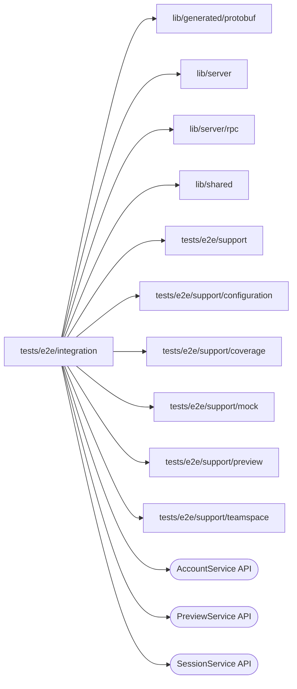

# Integration specs

<!-- BEGIN GENERATED DIRECTORY SUMMARY (scripts/check-readmes.mjs; edit only Purpose) -->
Purpose: Focused Studio scenarios that run against an existing environment and private fixtures; they are run one at a time and are not acceptance.

Importers: no production directory imports this directory.

Imports: it imports `lib/generated/protobuf`, `lib/server`, `lib/server/rpc`, `lib/shared`, `tests/e2e/support`, `tests/e2e/support/configuration`, `tests/e2e/support/coverage`, `tests/e2e/support/mock`, `tests/e2e/support/preview` and `tests/e2e/support/teamspace` and calls the `AccountService`, `PreviewService` and `SessionService` APIs.

<!-- END GENERATED DIRECTORY SUMMARY -->

`publishing-preparation.spec.ts` observes existing failed Releases through the
real Studio/BFF/gRPC path, without retrying preparation or builds: the Publish popover on a
version whose preparation failed shows its problem and admits none. Its build
failure case requires `SUPERVERSE_E2E_FAILED_BUILD_PROJECT`,
`SUPERVERSE_E2E_FAILED_BUILD_COMMIT` and private `SUPERVERSE_E2E_STORAGE_STATE`:
the source must be READY, the active build must actually have failed with
BUILD_FAILED, and GetRelease must return FAILED metadata with empty definitions
while Studio displays the failure. Missing fixtures fail rather than skip.
The failed-rebuild case needs `SUPERVERSE_E2E_FAILED_REBUILD_PROJECT` and
`SUPERVERSE_E2E_FAILED_REBUILD_COMMIT`: that Release must have a newer failed
build while its earlier READY build still serves Live. It checks the deployed
catalog and its Deployment ID header, and that Live Runs issue no GetRelease
preflight. It observes the Live run button without clicking it.

`oauth-connection.spec.ts` authorizes an oauth2-http v0.1.0 Teamspace
connection through the real Studio, BFF, Go server and the lane's Keycloak:
a new Teamspace's Connections page adds the app from its catalog, Keycloak's
login consents, and the callback creates the connection and returns to the
page with it connected. A second connection's refused consent returns
`OAUTH_DENIED` and leaves no connection.
It requires `SUPERVERSE_E2E_KEYCLOAK_ORIGIN` (the realm's origin as the
browser reaches it), `SUPERVERSE_E2E_KEYCLOAK_BACKCHANNEL` (as the server
reaches it: the same origin on Native, the in-cluster Service on Kind) and
`SUPERVERSE_E2E_KEYCLOAK_FILE` (the lane's private `keycloak-credentials.json`).

`problem-format.spec.ts` registers an account, creates a template Project on the mock model and
lets its first push reach the Preview, which refuses it for the connection its configuration lacks.
It requires the lane's Studio, server, Dex and local Git host, with the mock model offered. The
Preview's problem panel must show the four parts of the one problem format: what happened in words,
the server's message with the missing configuration, the Open Setup fix the server declared with
`PREVIEW_CONFIGURATION_INCOMPATIBLE`, and the folded technical details, which alone name the code,
the phase and the commit. It deletes the Project at the end.

`setup-draft.spec.ts` registers an account, creates a template Project on the mock model and lets
its first push reach the Preview, which lacks the `summary-model` connection. Setup has no Apply button;
Preview's state under its column lists the gap as a link that focuses its row. Selecting the Teamspace connection in
Setup's Preview column autosaves, and Setup applies it on its own: `StartPreview` with
`apply_configuration` and the saved revision, and the Preview runs. An edit of a variable autosaves and
is applied on its own the same way. A second tab's write of the same setting makes this tab's next write
show "Changed elsewhere", resolved with Take theirs; the Preview then runs that revision and Apply to
Preview has nothing left to apply. In the Next publish column the
variable follows Preview, becomes Live's own through "Different on Live…", written to the next-publish
layer under the one "Saving…", and follows Preview again with `followPreview`, as the layer's items report.
It requires the lane's Studio, server, Dex and local Git host with the mock model offered, and
the local platform mock LLM (no OpenAI key file) for the connection. It deletes the Project at the end.

`timeline/environment-timeline.spec.ts` creates a template Project on the mock model and lets its first push reach
the Preview, which refuses it. The History under the Interface's Preview must list that start as one row: the Agent
as the actor, the outcome refused, the version as "V1 · subject" and the commit hash only inside the
problem's folded details. It requires the same lane inputs as `problem-format.spec.ts` and deletes the
Project at the end.

The `remoteagent` child covers the actual Connect dialog, BFF and Bridge HTTP
with an explicit private disposable READY Project fixture. Its recordings are
off, and it cleans only its exact created connection IDs and secondary login;
see [the child README](remoteagent/README.md).
