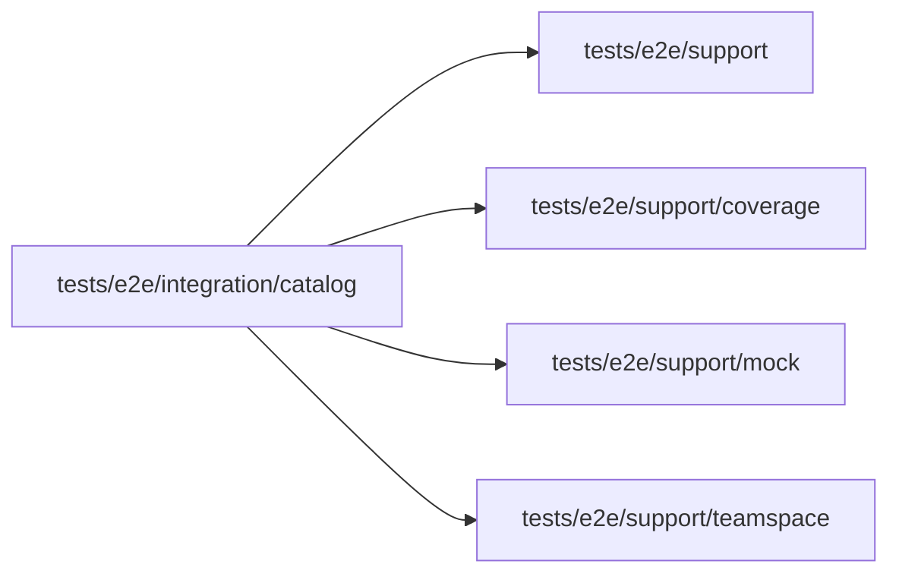

# Provider catalog integration

<!-- BEGIN GENERATED DIRECTORY SUMMARY (scripts/check-readmes.mjs; edit only Purpose) -->
Purpose: Exercises catalog admission, existing model mappings, persisted Claude selection and mock continuation through the real Studio, BFF, gRPC, Dex and Sandbox.

Importers: no production directory imports this directory.

Imports: it imports `tests/e2e/support`, `tests/e2e/support/coverage`, `tests/e2e/support/mock` and `tests/e2e/support/teamspace`.

<!-- END GENERATED DIRECTORY SUMMARY -->

`model-catalog.spec.ts` creates its own account, TeamSpace and disposable Project, selects Sonnet without calling it, reloads, then runs the explain scenario on mock. New provider selections must be refused without changing the revision.
