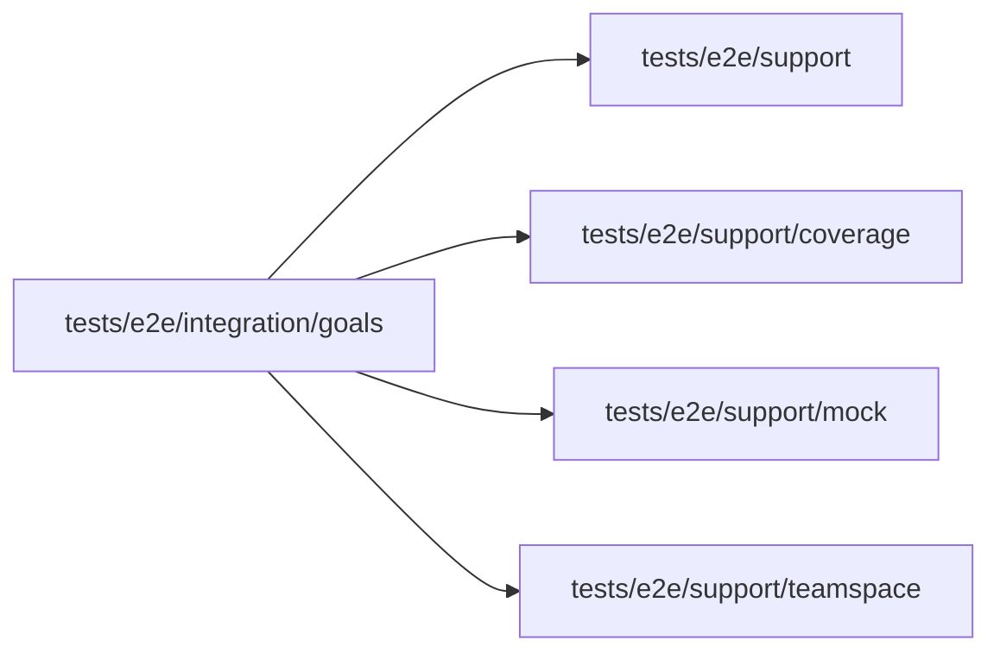

# Goals specs

<!-- BEGIN GENERATED DIRECTORY SUMMARY (scripts/check-readmes.mjs; edit only Purpose) -->
Purpose: The Goals tab spec: a Project never published answers NOT_FOUND to GetEvolve and Review now through the BFF and shows the empty state with Set goals.

Importers: no production directory imports this directory.

Imports: it imports `tests/e2e/support`, `tests/e2e/support/coverage`, `tests/e2e/support/mock` and `tests/e2e/support/teamspace`.

<!-- END GENERATED DIRECTORY SUMMARY -->
