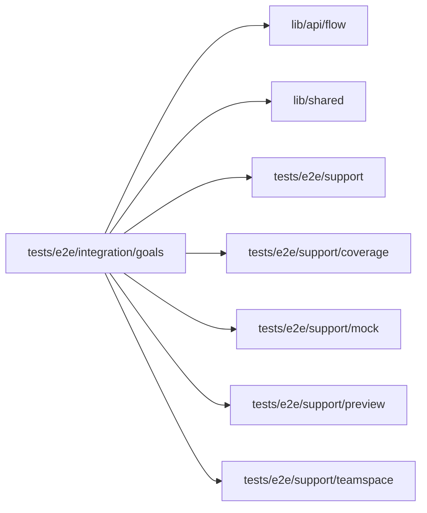

# Goals specs

<!-- BEGIN GENERATED DIRECTORY SUMMARY (scripts/check-readmes.mjs; edit only Purpose) -->
Purpose: The Goals tab specs: a never-published Project's empty state, and an agent review's proposal approved from the Goals tab or the chat card, then applied on Preview.

Importers: no production directory imports this directory.

Imports: it imports `lib/api/flow`, `lib/shared`, `tests/e2e/support`, `tests/e2e/support/coverage`, `tests/e2e/support/mock`, `tests/e2e/support/preview` and `tests/e2e/support/teamspace`.

<!-- END GENERATED DIRECTORY SUMMARY -->
