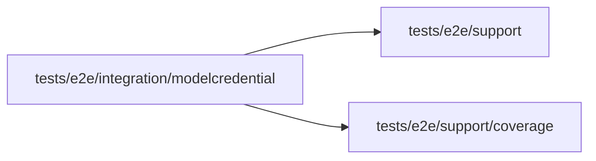

# Model credential acceptance

<!-- BEGIN GENERATED DIRECTORY SUMMARY (scripts/check-readmes.mjs; edit only Purpose) -->
Purpose: Verifies Project credential entry and composer admission through real dependencies.

Importers: no production directory imports this directory.

Imports: it imports `tests/e2e/support` and `tests/e2e/support/coverage`.

<!-- END GENERATED DIRECTORY SUMMARY -->
