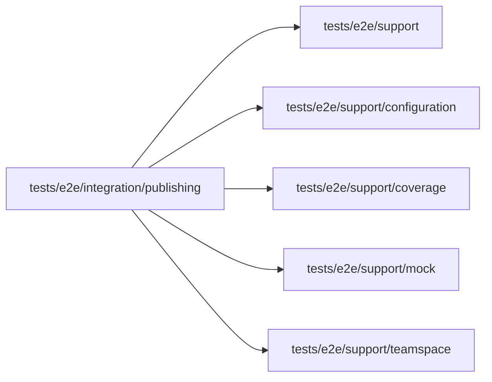

# Publishing integration specs

<!-- BEGIN GENERATED DIRECTORY SUMMARY (scripts/check-readmes.mjs; edit only Purpose) -->
Purpose: The Publish popover and cancellation on a local lane: the Preview validation or a skip reason, the stated consequences, Live's waiting settings, and a cancelled build.

Importers: no production directory imports this directory.

Imports: it imports `tests/e2e/support`, `tests/e2e/support/configuration`, `tests/e2e/support/coverage`, `tests/e2e/support/mock` and `tests/e2e/support/teamspace`.

<!-- END GENERATED DIRECTORY SUMMARY -->

`publish-popover.spec.ts` builds its own fixture on the real Studio, BFF, server, Dex and local Git
host: the `setup-live-versions` scenario pushes a version that never runs on Preview. The Publish
popover marks it "not in the Preview record" and keeps Publish disabled until a reason of at most 500
characters is written, and the server refuses a build of it without one (`PREVIEW_VALIDATION_REQUIRED`);
it is published with a reason, which Tools, Publishing's history shows. The scenario's second version
runs on Preview; the popover names the version it replaces, the new and no longer used settings, and
the connection and Teamspace connection Live will run with, and the build records the Preview start.
The popover on the Live tab then publishes a waiting environment value of the version Live runs: it
lists only that change beside Live's value, no Preview run is needed, and a new deployment of the same
Release runs the new configuration.

`publish-cancel.spec.ts` publishes the scenario's second version and cancels it while it builds: the
confirmation says Live keeps running its version, `CancelReleaseBuild` is sent for the build, the stage
bar stops at Build and reads "Publishing cancelled", Live's pointer is unchanged, the build ends
CANCELLED with who cancelled it and no deployment, and Live's history lists the cancelled publish.

Both require the mock model offered and `SUPERVERSE_E2E_OPENAI_FILE`, and stop Live and delete the
Project at the end. The helpers they build the fixture from are in `tests/e2e/support/configuration/`.
