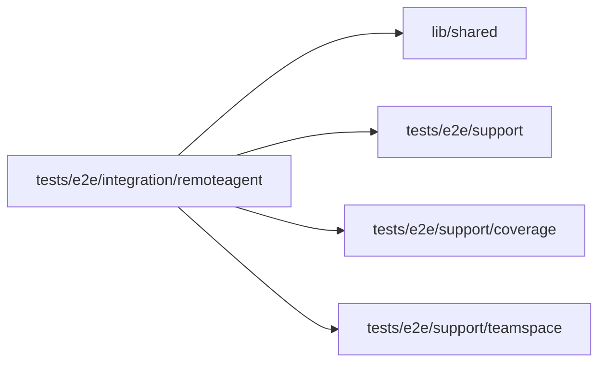

# Remote executor integration specs

<!-- BEGIN GENERATED DIRECTORY SUMMARY (scripts/check-readmes.mjs; edit only Purpose) -->
Purpose: Exercises real Studio pairing, public remote replies, and epoch-fenced takeover through the lane's existing BFF, gRPC, remote HTTP listener, SQL and Dex.

Importers: no production directory imports this directory.

Imports: it imports `lib/shared`, `tests/e2e/support`, `tests/e2e/support/coverage` and `tests/e2e/support/teamspace`.


<!-- END GENERATED DIRECTORY SUMMARY -->

Existing-Project cases use the Agent picker's single connection dialog and the
real lane. `start-local.spec.ts` instead registers its own account and Teamspace
and deletes each created Project, so it needs no external fixture. The creation case opens the Project before pairing and uses inline connection instructions in its chat.
They require `SUPERVERSE_E2E_REMOTE_AGENT_FIXTURE`, a private regular 0600 JSON
file accepted by `ownerProjectFixture`: owner `email`, `password` and `projectId`.
The Project must be READY with an idle ACTIVE mock-model Session, platform
executor, no connections, pending input, queued/steered messages or running tasks.
The remote listener must explicitly allow the development Bridge fixture.

| Spec                        | Actual behavior exercised                                                                                                                                                   |
| --------------------------- | --------------------------------------------------------------------------------------------------------------------------------------------------------------------------- |
| `connect-agent.spec.ts`     | Pairing without activation, explicit refresh, clipboard/countdown, exact revocation and keyboard reopen                                                                     |
| `start-local.spec.ts`       | Start form chooses a local agent, Project opens before pairing, editable draft survives reload, on-demand inline pairing, remote activation, exactly one edited first-message delivery after the activation cursor, manual sending after clearing the draft, a lost real-send response without replay after reload, and no model update                     |
| `executor.spec.ts`          | HTTP activation and public reply, then menu takeover using the observed string epoch; revoked credential returns 401                                                        |
| `offline-reconnect.spec.ts` | Real last-seen expiry beyond 90 seconds, remote authority preserved, ordinary composer queue, same-credential reconnect and cursor delivery exactly once                    |
| `takeover.spec.ts`          | A distinct Builder takes over; replaced but valid credential returns 409 `executor_changed`, while a platform switch revokes the selected credential with 401               |
| `switch-lifecycle.spec.ts`  | Navigation and real Builder-to-Operator demotion abort one pending browser switch; authorities remain unchanged and the actual BFF independently returns 403 after demotion |

The multi-person cases also require `builder: {email, password}` in the private
fixture. This must name a registered ordinary account, distinct from the owner
and administrator, already a MEMBER of the same Teamspace with no Project role.
The test resolves its actual account ID, adds only that exact Builder membership
and removes it on cleanup. The navigation case requires `otherProjectId`, a
distinct READY Project owned by the primary account in the same Teamspace.

`switch-gate.ts` delays exactly one Project/epoch-matched browser command before
dispatch. Watches and other requests continue normally. The test must observe
the browser's actual cancellation before releasing the gate; it never supplies
a fake response, alters a clock or fabricates permission state. The gate expires
after 90 seconds and failure cleanup aborts only its held request.

The existing E2E configuration runs one worker. Use this exclusive disposable
fixture serially, without other users or Bridge processes. Cleanup retains the
first assertion failure, reconciles uncertain mutations without retrying them,
and changes only test-owned queued IDs, connections, memberships and logins.
Current authority is reread before Stop, platform switch or exact revocation.
Automatic traces, screenshots and videos remain disabled to protect pairing codes and tokens. The creation cases capture explicit screenshots only before code generation and after connection, when no pairing code is visible.

These are acceptance sources, not observed runtime evidence. Real Native and
Kind runs remain required. The separate legal maximum-payload, stream-loss,
shutdown and pressure gates are not established by these browser cases.

## RPC coverage

The root Native and Kind acceptance runners execute only the three root cases;
they must not receive this directory's observations. After this directory's
real-dependency specs pass on a dedicated fresh Native run, merge that run's
private recorder with:

```sh
python3 scripts/rpc-coverage-map.py merge native-integration <native-rpc-coverage.json>
```

For the same specs on a freshly deployed Kind server, use `kind-integration`
and that Pod's private recorder instead. The recorder is cumulative for one
server lifetime, so do not reuse a recorder that served the root acceptance
cases; merge only after every requested remote-agent spec has passed.
