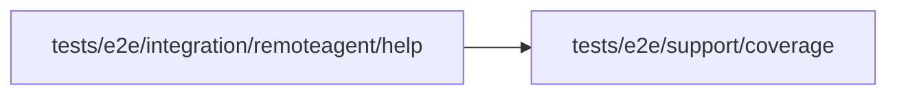

# Local agent help verification

<!-- BEGIN GENERATED DIRECTORY SUMMARY (scripts/check-readmes.mjs; edit only Purpose) -->
Purpose: Exercises the local agent help route, copyable setup commands, troubleshooting, permissions and narrow-screen layout against a real Studio server.

Importers: no production directory imports this directory.

Imports: it imports `tests/e2e/support/coverage`.

<!-- END GENERATED DIRECTORY SUMMARY -->
