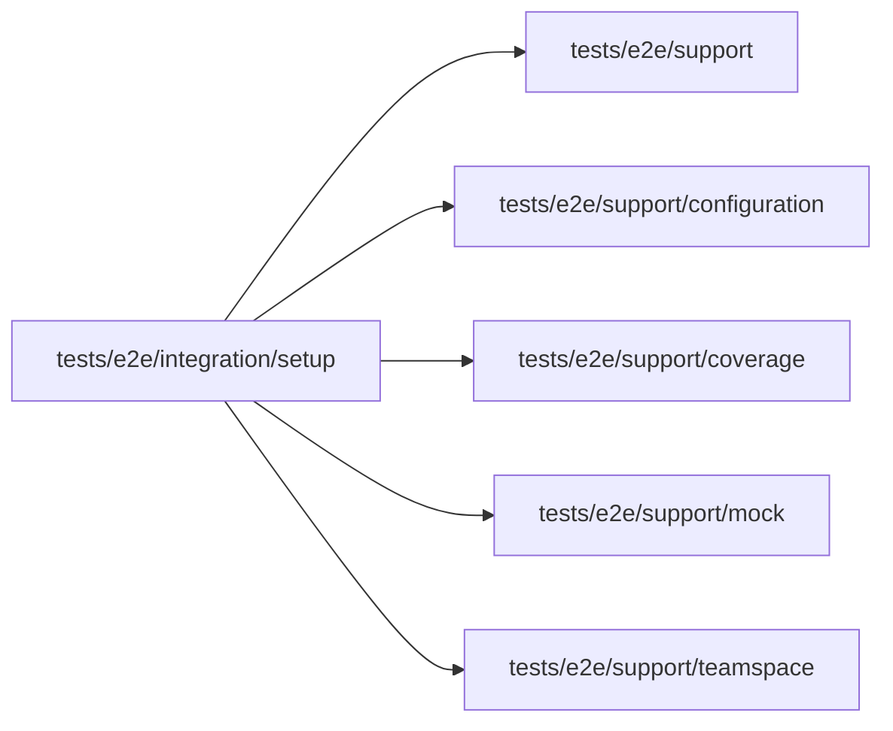

# Setup integration specs

<!-- BEGIN GENERATED DIRECTORY SUMMARY (scripts/check-readmes.mjs; edit only Purpose) -->
Purpose: Focused Tools, Setup scenarios on a local lane: the Live tab's banner and Next publish controls over two versions the mock model pushes.

Importers: no production directory imports this directory.

Imports: it imports `tests/e2e/support`, `tests/e2e/support/configuration`, `tests/e2e/support/coverage`, `tests/e2e/support/mock` and `tests/e2e/support/teamspace`.

<!-- END GENERATED DIRECTORY SUMMARY -->

`setup-live.spec.ts` builds its own fixture on the real Studio, BFF, server, Dex and local Git host:
the `setup-live-versions` scenario pushes a version declaring `SUMMARY_GREETING`, which the case
publishes to Live through the Publish popover with a skip reason, then one declaring `SUMMARY_TONE`, for which it applies a
value in Setup's Preview column. Setup on the Live tab must show its banner with the version Live runs and
nothing waiting; the summary connection and `SUMMARY_GREETING` are Live's own; a new greeting of Live's own
waits for a publish, with the blue dot naming what Live runs, and following Preview again leaves nothing
waiting; "Same as Preview" makes the connection follow Preview's with `followPreview`. It needs the mock
model, the local platform mock LLM (no OpenAI key file) for the summary connection, and removes
Live and the Project when it ends. The helpers it builds the fixture from are in
`tests/e2e/support/configuration/`.
