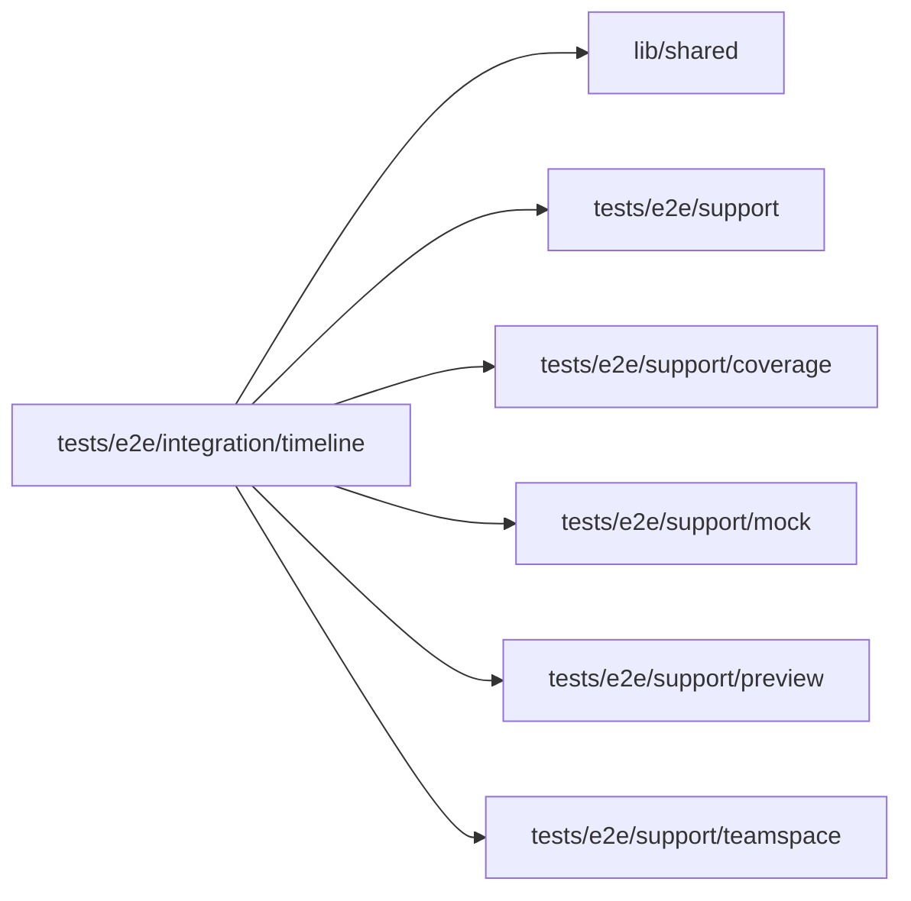

# Timeline and Process navigation specs

<!-- BEGIN GENERATED DIRECTORY SUMMARY (scripts/check-readmes.mjs; edit only Purpose) -->
Purpose: Exercises Preview history and Process navigation, including refused-push versions and query preservation across the shipped newsletter's two real Flows.

Importers: no production directory imports this directory.

Imports: it imports `lib/shared`, `tests/e2e/support`, `tests/e2e/support/coverage`, `tests/e2e/support/mock`, `tests/e2e/support/preview` and `tests/e2e/support/teamspace`.

<!-- END GENERATED DIRECTORY SUMMARY -->
