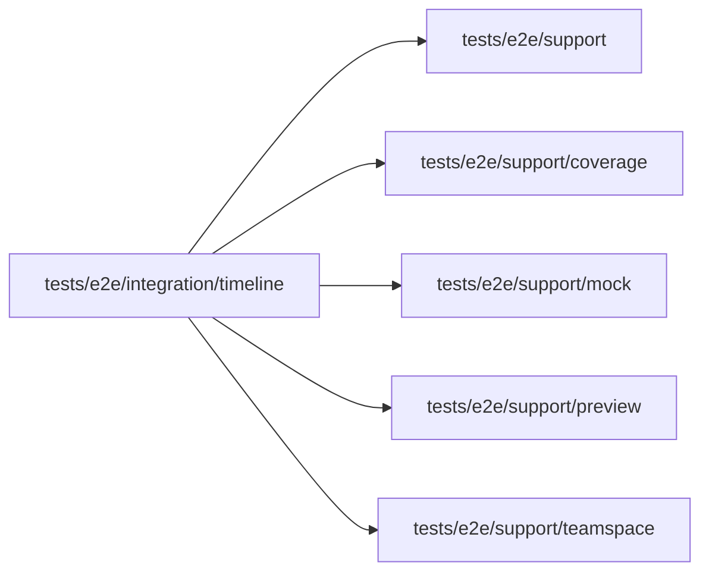

# Timeline specs

<!-- BEGIN GENERATED DIRECTORY SUMMARY (scripts/check-readmes.mjs; edit only Purpose) -->
Purpose: The environment timeline spec: the Interface's Preview History lists a refused push with its version and no commit hash.

Importers: no production directory imports this directory.

Imports: it imports `tests/e2e/support`, `tests/e2e/support/coverage`, `tests/e2e/support/mock`, `tests/e2e/support/preview` and `tests/e2e/support/teamspace`.

<!-- END GENERATED DIRECTORY SUMMARY -->
