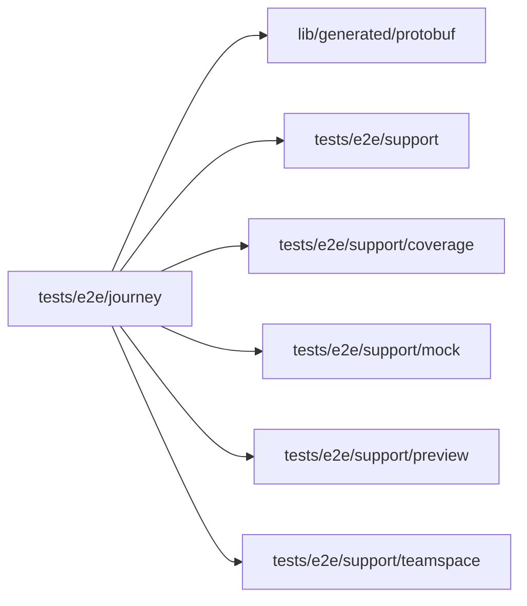

# Journey specs

<!-- BEGIN GENERATED DIRECTORY SUMMARY (scripts/check-readmes.mjs; edit only Purpose) -->
Purpose: Retained end-to-end journeys through the real Studio, model, GitHub, Sandbox and application APIs that keep the resources they create.

Importers: no production directory imports this directory.

Imports: it imports `lib/generated/protobuf`, `tests/e2e/support`, `tests/e2e/support/coverage`, `tests/e2e/support/mock`, `tests/e2e/support/preview` and `tests/e2e/support/teamspace`.

<!-- END GENERATED DIRECTORY SUMMARY -->
