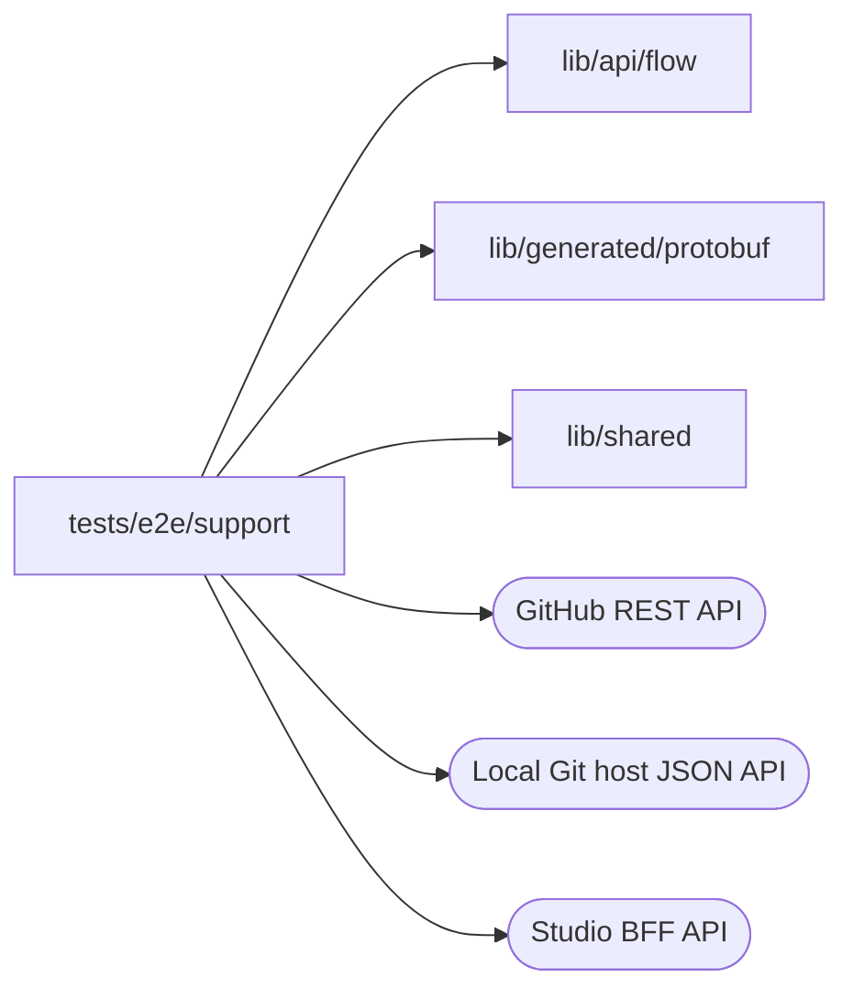

# E2E support

<!-- BEGIN GENERATED DIRECTORY SUMMARY (scripts/check-readmes.mjs; edit only Purpose) -->
Purpose: Modules the specs share: Studio BFF calls, accounts, Projects, configuration, publishing, Flow runs, Session transport, repository host reads, private fixtures and JSON assertions.

Importers: no production directory imports this directory.

Imports: it imports `lib/api/flow`, `lib/generated/protobuf` and `lib/shared` and calls the GitHub REST, Local Git host JSON and Studio BFF APIs.

<!-- END GENERATED DIRECTORY SUMMARY -->
