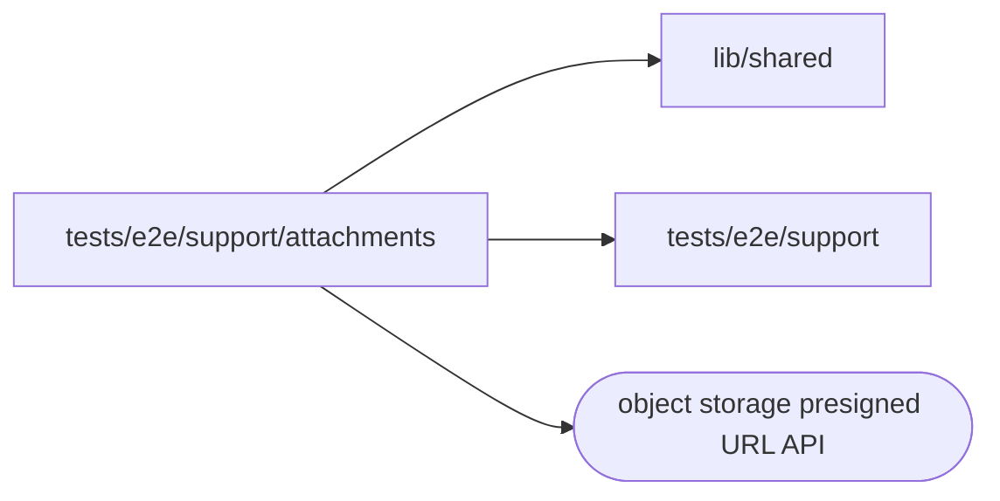

# Start page attachments

<!-- BEGIN GENERATED DIRECTORY SUMMARY (scripts/check-readmes.mjs; edit only Purpose) -->
Purpose: The E2E files a first message attaches on the start page, uploaded through presigned PUTs, and the checks of their delivery, downloads and chips once the Session shows them.

Importers: no production directory imports this directory.

Imports: it imports `lib/shared` and `tests/e2e/support` and calls the object storage presigned URL API.

<!-- END GENERATED DIRECTORY SUMMARY -->
