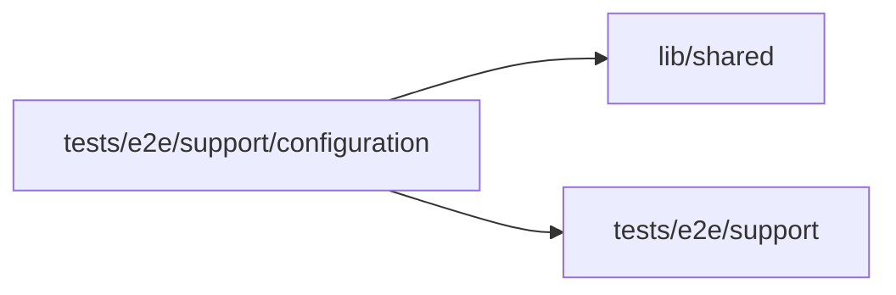

# Configuration recovery verification

<!-- BEGIN GENERATED DIRECTORY SUMMARY (scripts/check-readmes.mjs; edit only Purpose) -->
Purpose: Opt-in configuration helpers: the Native read-fault recovery case and the pieces of a two-version Live fixture for Setup's Live tab specs.

Importers: no production directory imports this directory.

Imports: it imports `lib/shared` and `tests/e2e/support`.

<!-- END GENERATED DIRECTORY SUMMARY -->

`recovery.ts` runs only when both `SUPERVERSE_E2E_NATIVE_READ_FAULT_RUN_FILE`
and `SUPERVERSE_E2E_NATIVE_READ_FAULT_RUN_ID` identify the developer-owned ready
Native run. It proves the retained owner, health header and exact server PID,
process group, start time and executable before signaling that server.
The server resumes in `finally`, with an 80-second watchdog as a backstop.
It never signals a process of Kind or another Native run. The browser talks to
the actual BFF and gRPC server throughout; no response is intercepted or replaced.
Its attachment contains only identities, timings, attempt counts and statuses.

`live-versions.ts` holds the pieces of a Project whose Live runs one version while a newer version
declares other configuration: publishing a chosen version through the bar's Publish, a variable's
control in either column of Setup and filling it (a next-publish value that follows Preview becomes Live's
own first), and Apply to Preview, which applies at once what Setup would apply on its own and waits until
the Preview serves the head with that configuration applied. `setup-live.spec.ts` and `setup-draft.spec.ts` build their fixtures from them.
