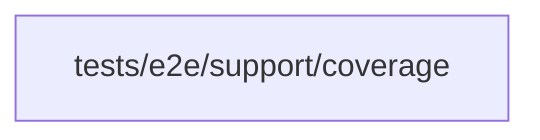

# Spec coverage

<!-- BEGIN GENERATED DIRECTORY SUMMARY (scripts/check-readmes.mjs; edit only Purpose) -->
Purpose: Records, for each passing E2E spec, the Studio source files whose code ran in its browser pages, for the committed coverage map.

Importers: no production directory imports this directory.

Imports: it imports no other Studio directory and calls no remote API.

<!-- END GENERATED DIRECTORY SUMMARY -->

Every spec imports `test` and `expect` from `spec-coverage.ts`. With `SUPERVERSE_E2E_COVERAGE_DIR` set, its automatic
fixture records the block coverage of every page of the test's context and of the contexts the spec creates with
`browser.newContext`. A document load discards the coverage of the document it leaves, so the fixture takes it before
each `page.goto` and `page.reload`; a load the page starts itself, such as a redirect, loses it, and the code it
covered usually runs again in the next document. A Studio file counts as run when a source map segment of its
generated code lies in a range that ran, such as the top-level statements of a module the page imported or the body of
a function it called; the body of a function never called does not count. Only when the spec passed does the fixture write `<spec>.json` into that directory.

A Studio build without browser source maps yields no files: Native `--studio build` emits them
(`SUPERVERSE_STUDIO_SOURCE_MAPS=true`); Kind images and hosted builds do not. Server-side code, style sheets and type
declarations never reach the browser, so no spec records them.

`scripts/studio-coverage-map.py` merges the records into `tests/e2e/coverage-map.json`, replacing only the specs that
ran, and `make affected-specs` reads the map to name the specs that run the files a change touches; the evidence check
requires one of them for each such file
([integration verification](../../../../../../internal/dexai/agents/README.md)).
