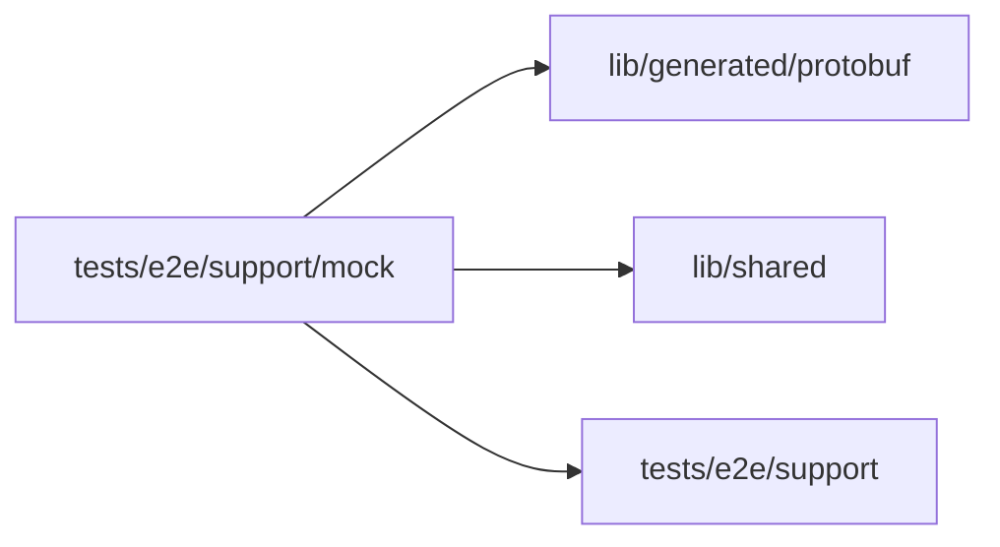

# E2E mock composer

<!-- BEGIN GENERATED DIRECTORY SUMMARY (scripts/check-readmes.mjs; edit only Purpose) -->
Purpose: Drives the mock model's composer: whether the lane offers it and the Session runs it, the first input chosen on the creation page, and each later input in order.

Importers: no production directory imports this directory.

Imports: it imports `lib/generated/protobuf`, `lib/shared` and `tests/e2e/support`.

<!-- END GENERATED DIRECTORY SUMMARY -->

The specs never write scenario markers: they choose a scenario's category (from the catalog),
the scenario and its arguments in the mock composer, wait until it names the input they expect
next and send it, as a person does, on the creation page for the first input and in the
Session for the others. They ask the server (`ListMockScenarios`) whether the lane offers the mock
model before the Project exists, and read from the Session's Snapshot whether it runs it. A reply of the mock model itself, such as an input out of order, fails the
spec with its text.
