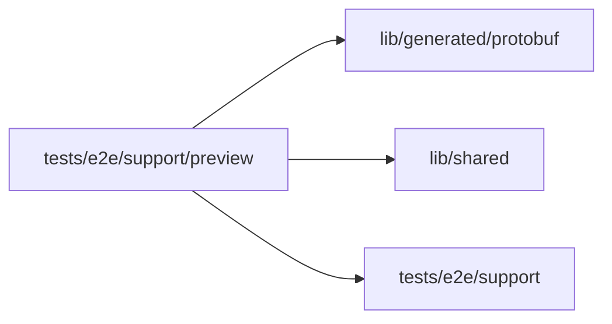

# Preview helpers

<!-- BEGIN GENERATED DIRECTORY SUMMARY (scripts/check-readmes.mjs; edit only Purpose) -->
Purpose: The specs' Preview steps: starting it from the Interface, awaiting a push's automatic deployment or its configuration notice, and previewing the template's heading edit.

Importers: no production directory imports this directory.

Imports: it imports `lib/generated/protobuf`, `lib/shared` and `tests/e2e/support`.

<!-- END GENERATED DIRECTORY SUMMARY -->
