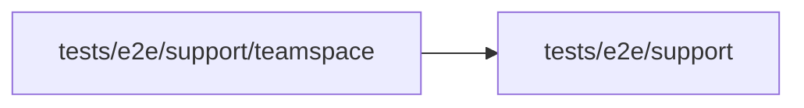

# Teamspace steps

<!-- BEGIN GENERATED DIRECTORY SUMMARY (scripts/check-readmes.mjs; edit only Purpose) -->
Purpose: E2E steps of a Teamspace's people: create or open a Teamspace, add a member in People, give a Project role in Permissions and open a Project as an operator.

Importers: no production directory imports this directory.

Imports: it imports `tests/e2e/support`.

<!-- END GENERATED DIRECTORY SUMMARY -->

Reads and authorization use the read model, which a change reaches within seconds, so the steps that act on a
change made a moment ago, such as a new member's Project role or an operator opening the Project, ask again for up to
a minute.
